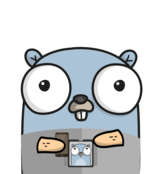

[](https://circleci.com/gh/alexfalkowski/einblick)
[](https://codecov.io/gh/alexfalkowski/einblick)
[](https://pkg.go.dev/github.com/alexfalkowski/einblick)
[](https://masterminds.github.io/stability/active.html)

# 🔭 Einblick

Einblick is an OpenTelemetry service for applications built on go-service.
It receives logs, metrics and traces over gRPC and prints them through the
service logger. Received records are discarded after printing.

Searchable DuckDB storage and Parquet archives in Cloudflare R2 are planned.
See the [product requirements](docs/requirements.md) and
[implementation plan](docs/review-and-plan.md) for the remaining work.

## 🚀 Quickstart

Use Go, Ruby with Bundler, Make and a C/C++ compiler. See
[development](docs/development.md) for toolchain details.
Run these commands from the repository root:

```sh
git submodule sync
git submodule update --init
make dep
make build
./einblick server -config file:test/.config/server.yaml
```

In another terminal, check readiness:

```sh
curl --fail http://localhost:11000/einblick/readyz
```

The development configuration listens on HTTP port `11000` and gRPC port `12000`.

## 📥 Telemetry ingestion

Send standard OTLP/gRPC log, metric and trace exports to the gRPC listener, including with gzip.
See [telemetry ingestion](docs/ingestion.md) for receipt behavior, responses and a local
client example. Successful exports acknowledge receipt only; telemetry is not stored.

## ⚙️ Configuration

See [configuration](docs/configuration.md) for the development settings,
telemetry exporters, request limits and timeouts.

## 🛠️ Operations

See [operations](docs/operations.md) for health endpoints, container builds,
release and deployment. Storage and query capabilities remain planned.

## 🧪 Development

See [development](docs/development.md) for the Cucumber harness, test output and
validation. Go API documentation is available on
[pkg.go.dev](https://pkg.go.dev/github.com/alexfalkowski/einblick), and release
history is available in [GitHub releases](https://github.com/alexfalkowski/einblick/releases).
