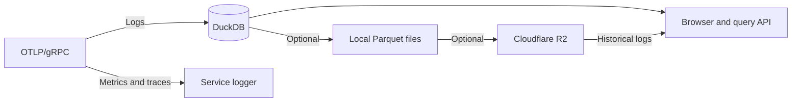

[](https://circleci.com/gh/alexfalkowski/einblick)
[](https://codecov.io/gh/alexfalkowski/einblick)
[](https://pkg.go.dev/github.com/alexfalkowski/einblick)
[](https://masterminds.github.io/stability/active.html)

# 🔭 Einblick

Einblick is an OpenTelemetry service for applications built on go-service.
It receives logs, metrics and traces over gRPC. Logs commit to local DuckDB
before acknowledgement. Metrics and traces are printed and discarded.

## 🚀 Quickstart

Use Go, Ruby with Bundler, Make, a C/C++ compiler and native DuckDB
headers/library. macOS development uses Homebrew DuckDB; the configured CI image
includes the native dependency. See [development](docs/development.md) for details.
Run these commands from the repository root:

```sh
git submodule sync
git submodule update --init
make dep
make build
(cd test && ../einblick server -config file:.config/server.yaml)
```

In another terminal, check readiness:

```sh
curl --fail http://localhost:11000/einblick/readyz
```

The development configuration listens on HTTP port `11000` and gRPC port `12000`.
Its local database is `test/reports/recent.duckdb`. This development location is
disposable; use a persistent mount to retain accepted logs.

## 📥 Telemetry ingestion



See [telemetry ingestion](docs/ingestion.md) for OTLP/gRPC methods, gzip,
responses and local examples. See [local Parquet export](docs/configuration.md#-local-parquet-export)
and [R2 publication](docs/configuration.md#-r2-log-archives) to configure archival.

## 🔎 Log queries

Open `http://localhost:11000/logs` to investigate acknowledged logs with
service, severity, string-body text and trace-ID filters. The Logs page
uses your browser language preferences and displays expandable typed log
details. With R2 configured, the same search includes archived logs. See
[log queries](docs/queries.md) for the browser and API usage.

## ⚙️ Configuration

See [configuration](docs/configuration.md) for the development settings,
telemetry exporters, request limits and timeouts.

## 🛠️ Operations

See [operations](docs/operations.md) for health endpoints, persistent storage,
deployment and log recovery.

## 🧪 Development

See [development](docs/development.md) for the Cucumber harness, test output and
validation. Go API documentation is available on
[pkg.go.dev](https://pkg.go.dev/github.com/alexfalkowski/einblick), and release
history is available in [GitHub releases](https://github.com/alexfalkowski/einblick/releases).

## 🧭 Roadmap

Persistence, archive queries and views for metrics and traces are planned.
See the [product requirements](docs/requirements.md) and
[implementation plan](docs/review-and-plan.md).
