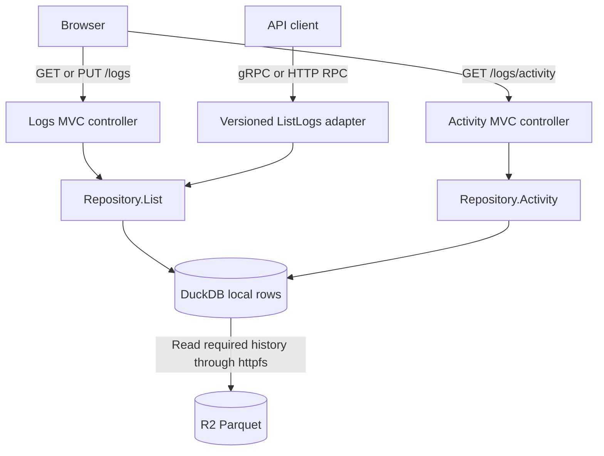

# 🧪 Development

[← Back to README](../README.md)

## 🏁 Setup

Follow the [quickstart](../README.md#-quickstart). Use the Go version in
[go.mod](../go.mod) and Ruby with Bundler. Building DuckDB support requires CGO
and a C/C++ compiler.

The Ruby test client also needs native DuckDB headers and a shared library
compatible with the gem pinned in [test/Gemfile.lock](../test/Gemfile.lock).
On macOS, install DuckDB through Homebrew:

```sh
brew install duckdb
```

The gem detects Homebrew without extra build flags. The configured
[CI image](../.circleci/config.yml) already supplies the native dependency.

## 🧱 Local dependencies

From the Einblick repository root, run `make start` when you need the shared
Floci emulator for R2 scenarios or the OpenTelemetry collector for outgoing
traces. The local-only Logs quickstart serves requests without the shared
stack. Run `make stop` when you are done using the stack.
[Shared local dependencies](https://github.com/alexfalkowski/docker#-local-dependencies)

## 🥒 Tests and checks

Run commands from the repository root. The Cucumber/Nonnative harness starts
the server with [test/.config/server.yaml](../test/.config/server.yaml).
Choose the feature group you are changing.

```sh
make features-storage
make features-archive
make features-queries
make features-site
make features-service
```

`make features-archive` runs every archive scenario. Use `make features-archive-staging`
for local Parquet staging and `make features-archive-publication` for all R2 scenarios.
`make features-archive-upload` runs upload and publication recovery scenarios.
`make features-archive-history` runs historical search and eviction scenarios.
The R2 groups use Floci from the shared stack on port `4566`, with the
test relay on port `4567`. Set `EINBLICK_FLOCI_PORT` if your local emulator
listens on a different port. The scenarios create and delete objects in a
disposable test bucket. CI pins its Floci image in the
[archive executor](../.circleci/config.yml).

The publication scenarios use Einblick's R2 startup to install and load
`httpfs`. The test user needs a writable home and access to DuckDB's extension
repository when the extension is absent.
[R2 configuration](configuration.md#-r2-log-archives)

The storage group includes migrations. The service group covers health, metric
and trace receipt, and scenarios outside the four tagged groups. Put each new
scenario in at most one of `@storage`, `@archive`, `@queries`, and `@site`.
Add `@publication` to archive scenarios that require Floci. Add `@archive_history`
when the scenario covers historical searches or local eviction. Use the CI
partition targets to run a smaller group locally.

| Make target | Scenarios |
| --- | --- |
| `make features-archive-upload-transfer` | Uploads, multipart, and acknowledgement recovery |
| `make features-archive-upload-recovery` | Staging repair, cleanup, and publication scheduling (`@archive_publication_recovery`) |
| `make features-archive-history-reads` | Historical reads, pagination, and eviction |
| `make features-archive-history-availability` | Archive outages, retention, and cancellation (`@archive_history_availability`) |

The upload and history targets without a suffix each run both of their
partitions. `make features` runs all feature scenarios.
Use `make features tags=@printing` or `make features feature=features/migrate`
to narrow a local run. Run groups one at a time locally because they share ports
and the test database. Run `make coverage` to merge the profiles in `test/reports/`
and write `coverage.html` in that directory.

In [CircleCI](../.circleci/config.yml) the groups run in separate jobs. Each job
stores its test reports and passes its raw Go coverage profiles to the coverage
job. The coverage job merges the profiles for a single Codecov upload.

Shared actions live in `test/lib`; [fixtures](../test/fixtures/README.md) provide
synthetic OTLP payloads. Storage scenarios stop the server before inspecting its
database. Some scenarios reset that database, so use only the disposable test
configuration. Logs and reports go to `test/reports/`.

Use `make lint` for Go, Ruby and protobuf checks and `make help` for other commands.
After documentation edits, run:

```sh
python3 tools/check_handoff.py
```

## 🦆 Storage

`internal/duckdb` opens, instruments and closes the shared database.
`internal/logs/storage` keeps the `Repository` interface and its
`newRepository` constructor in `storage.go`. The database implementation and
transactional `Add` operation live in `repository.go`. Add SQL files under
`queries/` and refer to them by their package-relative paths. The directory
embed includes subdirectories. The storage module uses
[`internal/database/query`](../internal/database/query) to load the SQL text once
during construction.
The Logs module applies the repository logging decorator and registers archive
metrics in [`internal/logs/telemetry`](../internal/logs/telemetry). Storage
supplies the backlog snapshot used by the metrics callback.



The [typed API adapter](../internal/api/v1/logs/list.go) converts request and
response messages. The [MVC controller](../internal/site/logs/controller/controller.go)
handles form inputs and renders the page or fragment. List and Activity share
the query deadline and admission policy. One local query and two
archive-inclusive queries can run independently. Activity uses an archive slot
only when a slot remains available for a log page. Waiting searches can cancel.
Log ingestion writes through `Repository.Add` independently of query admission.
See [pagination](queries.md#-results-and-pagination) for cursor behavior.

Keep timestamps as unsigned nanoseconds. Writes bind decimal strings to
`UBIGINT` to preserve the full unsigned range; conversions through floating-point
values or lower-precision timestamp types can lose data.

The [Logs module](../internal/logs/module.go) wires staging and R2 publication. Keep changes
in the package that owns the behavior.

| Package | Owns |
| --- | --- |
| [archive](../internal/logs/archive) | Batch identity, export and publication policy. |
| [storage](../internal/logs/storage) | Durable batch and upload state, Parquet export and DuckDB verification. |
| [staging](../internal/logs/archive/staging) | Workspace recovery, temporary files, checksums, final rename and file cleanup. |
| [r2](../internal/r2) | R2 connection settings, conditional S3 writes and streamed content verification. |
| [worker](../internal/logs/archive/worker) | Workspace preparation and scheduling of recovery, exports and publication. |

See [local Parquet staging](operations.md#-local-parquet-staging) for the recovery flow.

The v1 Parquet projection includes `log_id`, the four unsigned nanosecond
columns, and the stored protobuf JSON for `resource`, `scope` and `record`.
Readers can use DuckDB's `read_parquet` with `hive_partitioning = false` to read
the columns stored in completed files. The batch's logical digest covers these
columns in log-ID order. The staged file checksum covers the current Parquet
bytes.

## 🔌 Query API

The [protobuf contract](../api/einblick/v1/service.proto) defines the generated
gRPC and HTTP RPC request/response messages. `internal/api/v1` composes the
query operation and its `NewServer`/`Register` transport adapters. HTTP uses
`POST /einblick.v1.Service/ListLogs`; select `application/pbjson` for canonical
protobuf JSON with RFC 3339 Timestamp values. See [query usage](queries.md).

After changing the contract, regenerate Go and Ruby clients with:

```sh
make proto-format
make proto-generate
make proto-lint
```

Buf downloads the dependencies pinned in [api/buf.lock](../api/buf.lock) and
uses the remote plugins in [api/buf.gen.yaml](../api/buf.gen.yaml). Update the
OTLP schema dependency together with the Go and Ruby OTLP messages. Generated
files are checked in; edit the proto source and regenerate them.

## 🖥️ Logs site

The shared MVC server renders the embedded templates in
[`internal/site`](../internal/site). `GET /logs` returns a full document, and
the form and pagination use `PUT /logs` to replace the results fragment.
`GET /logs/activity` returns a separate chart fragment for the applied filters
and bounds. The [Logs route package](../internal/site/logs/route) wires these
requests to the controllers. Change the [Logs views](../internal/site/logs/view)
for page-specific markup and `root/layout` for the shared layouts.
Keep user-facing strings in each [locale catalog](../internal/site/locales).
The [full-page layout](../internal/site/root/layout/full.tmpl) pins htmx and the
daisyUI component stylesheets from jsDelivr with Subresource Integrity,
following Web. Use the shared daisyUI controls with the Einblick theme.

Edit the Logs CSS and JavaScript sources by component. Add new files to the
corresponding manifest in CSS cascade or JavaScript execution order. A regular
Go build embeds the sources. At startup, MVC assembles each bundle in manifest
order and generates its URL from the served bytes. The site returns `404` with
`Cache-Control: no-store` for outdated fingerprints.
[CSS sources](../internal/site/logs/assets/styles) ·
[CSS manifest](../internal/site/logs/assets/logs.css.tmpl) ·
[JavaScript sources](../internal/site/logs/assets/scripts) ·
[JavaScript manifest](../internal/site/logs/assets/logs.js.tmpl)

Templates send exact RFC 3339 timestamps and UTC fallback text. The Logs script
formats user-facing times after initial render and fragment updates. It converts
Custom picker values to UTC when collecting form data. The repository and
shareable URLs continue to use absolute bounds.

## 🪿 Schema migrations

Application migrations live in `internal/migrate/migrations/`. Goose discovers
the numbered SQL files through `embed.FS` and applies pending migrations before
the listeners start. Its DuckDB history queries live in
[`internal/migrate/queries/`](../internal/migrate/queries).
[`dialect.go`](../internal/migrate/dialect.go) embeds that directory and checks
that all six required queries are present when it constructs the querier at startup.

For a schema change, add a numbered SQL file with a `-- +goose Up` section and
extend `test/features/migrate`. After release, leave applied migrations unchanged.
Each migration and its history entry commit together. Define the supported
rollback behavior for the change; see [recovery guidance](operations.md#-log-storage-and-recovery).

## 📦 Container builds

With Docker available, build for the required platform:

```sh
make build-docker platform=arm64
```

Use `platform=amd64` for that target. Keep `static=0` in the [Makefile](../Makefile):
DuckDB needs CGO and a compatible C/C++ runtime in the container.

For an R2-enabled container, set `HOME=/data` in Infraops so DuckDB stores
`httpfs` on the existing writable data volume. DuckDB creates the version and
platform subdirectories under `/data/.duckdb/extensions` and reuses the files
after restart. The container root can stay read-only.
[DuckDB extension installation](https://duckdb.org/docs/2.0/extensions/installing_extensions)

## 📚 Product and design

The [requirements](requirements.md) define product behavior, and the
[implementation plan](review-and-plan.md) contains the remaining work.
The [initial design reference](requirements.md#87-service-catalog-and-standard-ux)
guides changes to the browser workflows.
