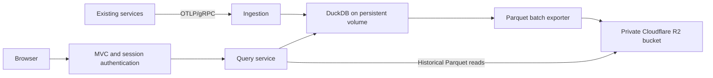

# Telemetry service: first-version requirements

**Status:** Working draft for refinement; no service implementation is claimed.  
**Revision:** 0.1  
**Created / last updated:** 2026-11-02  
**Working name:** einblick — proposed, not finalized.  
**Audience:** Product owner, implementing agents, reviewers, and service operators.  
**Intended permanent location:** The new service repository, at docs/requirements.md or its existing requirements-document location.

This document captures the design discussion as a self-contained specification. It distinguishes agreed direction, proposed defaults, implementation requirements, and unresolved decisions. It is currently a standalone planning artifact, not a change to go-service or infraops.

## 1. How to read and refine this document

- **Agreed direction** records choices established in the discussion.
- **Working design** records the architecture developed in the discussion. Its detailed mechanics still need implementation and verification.
- **Proposed default** is a concrete starting value that may be refined; it is not a measured capacity or service-level guarantee.
- **Open decision** identifies a choice that could materially affect implementation or operation.
- **MUST** describes required behavior for the proposed first version. It does not mean that behavior exists today.
- Requirement IDs are stable. Acceptance scenarios and implementation reports should refer to these IDs.

The product owner can refine any draft requirement. Record material changes in the revision history and update affected acceptance scenarios. Preserve IDs; mark superseded requirements rather than silently reusing their IDs.

Routine implementation details should follow the owning repository's conventions. Agents should not repeatedly request confirmation for details already settled here. An unresolved decision should block only work that genuinely depends on it.

## 2. Purpose and desired outcome

Build a small, single-instance Go service that receives OpenTelemetry logs, metrics, and traces from existing services, stores recent writes locally, archives telemetry in Cloudflare R2, and provides an embedded browser interface for investigation.

The product should make these workflows straightforward:

1. Find errors and relevant log records for an application and time range.
2. Open a distributed trace, inspect its spans, and find related logs.
3. Inspect basic metric charts for a service, instance, or attribute selection.
4. Search historical telemetry without downloading the entire archive at startup.
5. Recover from ordinary restarts without losing locally committed records.

The service should remain understandable to a small engineering team. Prefer an existing database and standard file formats over maintaining a custom query engine.

## 3. Decision register

| ID | Topic | Direction | Status |
| --- | --- | --- | --- |
| D-001 | Service ownership | A separate service and repository; use existing go-service facilities where appropriate. | Agreed direction |
| D-002 | Deployment size | One service instance initially. | Agreed direction |
| D-003 | Signals | Logs, metrics, and traces are all part of the first version. | Agreed direction |
| D-004 | Database | DuckDB is the selected candidate; verify the actual driver, engine version, packaging, and workload before production adoption. | Selected for validation |
| D-005 | CGO | Allow this service to opt into CGO. Preserve the existing shared build default for other services. | Agreed direction |
| D-006 | Archive | Use Parquet files in Cloudflare R2. | Agreed direction |
| D-007 | Recent queries | Prefer bounded memory and tunable query latency over keeping gigabytes of telemetry resident in RAM. | Agreed direction |
| D-008 | Ingestion transport | Standard OTLP/gRPC on an internal cluster endpoint. OTLP/HTTP is not required for the first version. | Agreed direction |
| D-009 | Frontend | Use go-service MVC and embedded assets; the web service is the reference implementation. | Agreed direction |
| D-010 | Frontend libraries | Follow the web example with htmx and Pico CSS; uPlot is a candidate for charts. | Proposed library choices |
| D-011 | Retention | Configurable; seven days is acceptable for normal operation. Use a shorter value while testing. | Agreed direction |
| D-012 | UI authentication | Read credentials from a mounted file configured by the service; authenticate once and remember the browser session. | Agreed direction |
| D-013 | Local persistence | A persistent volume holds DuckDB, its WAL, and pending exports. | Working design |
| D-014 | Acknowledgement | Acknowledge accepted telemetry after a successful local DuckDB commit; R2 upload is asynchronous. | Working design; durability consequence documented below |
| D-015 | Rollout | Enable one existing application first, measure the real workload, then expand. | Agreed direction |

The decision to evaluate DuckDB supersedes earlier suggestions to start with compressed OTLP archive files or choose FrostDB for the first implementation. Revisit the engine only if the feasibility work supplies a concrete reason.

## 4. Scope

### Included in the first version

- Standard OTLP/gRPC ingestion for the three selected signals.
- Local DuckDB persistence and crash recovery.
- Bounded database memory and query resource use.
- Immutable Parquet export batches and resumable uploads to R2.
- UTC daily archive partitioning, initially containing multiple applications.
- Recent and historical queries through an embedded MVC frontend.
- File-based operator credentials and simple browser sessions.
- Configurable retention, including a shorter test setting.
- Basic operational status, resource visibility, and recovery scenarios.
- A one-application pilot and measured capacity notes.

### Outside the first-version scope

- Multiple active writers or a distributed database.
- Multi-tenant billing, tenant isolation, account administration, and role management.
- A new query language, full PromQL or TraceQL compatibility, or a browser SQL console.
- A custom general-purpose filtering or aggregation engine.
- A second interchangeable database backend.
- Alert-rule management, notification delivery, or dashboard authoring.
- Custom full-text indexes or per-application physical partitions without measured need.
- Archive compaction unless initial measurements show it is necessary.
- Continuous replication of a live DuckDB database file to object storage.

These exclusions limit initial implementation scope; they do not require speculative extension points.

## 5. Vocabulary

| Term | Meaning |
| --- | --- |
| Signal | Logs, metrics, or traces. |
| Record | A log record, span, or metric data point, retaining its resource and instrumentation-scope context. |
| Export request | One incoming OTLP request. It is not automatically an archive batch. |
| Archive batch | A closed, immutable record set for one signal and one UTC event-day partition. It maps to one Parquet object and has a stable batch ID. |
| Pending export | A durable local job identifying an archive batch that is not yet confirmed in R2. |
| Recent dataset | Records retained locally for fast querying. This does not promise physical RAM residency. |
| Archive | Successfully uploaded Parquet batches in R2. |
| Application | A logical service identified principally through OpenTelemetry service resource attributes. |
| Instance | A particular service instance; distinguish it from the service name when interpreting metrics. |

## 6. Existing ecosystem: observations, not capacity guarantees

Inspected on 2026-11-02:

- The repositories with .cd markers are abgleich, bezeichner, standort, and web.
- The checked-in infraops application definition configures 1, 2, 2, and 2 replicas respectively: seven replicas in total.
- Their inspected runtime configurations use info-level text logging and omit metrics/tracing configuration. Introducing the backend therefore also requires enabling the desired OTLP exporters in clients.
- go-service installs OpenTelemetry runtime and host instrumentation when metrics are enabled. Its vendored versions contribute approximately 20–21 scalar series per instance before transport metrics.
- HTTP/gRPC instrumentation supplies additional spans and histograms. HTTP client phase tracing can create several spans for one outbound request.
- Redis and SQL instrumentation contribute data only when those dependencies are configured.
- The current shared Go container build uses CGO_ENABLED=0 and a distroless/static runtime image.
- The app model currently mounts config and secrets, uses a read-only root filesystem, and specifies ephemeral-storage budgets. It does not currently create persistent application data volumes.
- infraops contains R2 provisioning support, but its inspected production Cloudflare configuration does not declare a bucket. This does not establish whether a bucket exists outside that configuration.
- web already demonstrates embedded templates, MVC full/partial views, htmx, and Pico CSS.

These are source observations, not observations of live cluster state. They must be rechecked when implementation begins. Replica counts and instrumentation definitions do not establish actual log rates, span rates, attribute cardinality, or retained record sizes.

## 7. Working architecture



All service components run in one executable. The persistent volume and R2 bucket are external storage resources, not additional application services.

An illustrative local layout is:

```text
/data/
  recent.duckdb
  recent.duckdb.wal
  exports/
  tmp/
```

The WAL is managed by DuckDB. It may not exist after a clean checkpoint or shutdown. The application must not treat its absence as an error or manipulate it as an independent replication stream.

An illustrative archive layout is:

```text
v1/signal=logs/day=2026-11-02/<batch-id>.parquet
v1/signal=metrics/day=2026-11-02/<batch-id>.parquet
v1/signal=traces/day=2026-11-02/<batch-id>.parquet
```

The bucket is scoped to this installation initially. Application identity is stored in columns. Day partitioning supports read selection and lifecycle reasoning; it does not require one large file per day.

## 8. Functional requirements

### 8.1 Ingestion

- **ING-001 — Standard transport.** Expose the standard OTLP/gRPC export services for logs, metrics, and traces. Existing go-service clients must not need custom exporters.
- **ING-002 — Commit acknowledgement.** A successful response must mean the accepted records have committed to local persistent DuckDB storage. An in-memory queue alone is insufficient.
- **ING-003 — Protocol responses.** Report invalid, unsupported, partially accepted, and temporarily unavailable input using the appropriate OTLP responses. Valid empty requests must be handled according to OTLP.
- **ING-004 — Bounded input.** Configure request-size and concurrent-ingestion bounds. Do not allow decoding or buffering to bypass the intended service memory budget.
- **ING-005 — Backpressure.** When local capacity cannot safely accept a request, return an appropriate retryable OTLP failure. Do not silently discard already accepted records to make room.
- **ING-006 — Gzip.** Support the compression behavior needed by the standard OTLP/gRPC clients, including gzip.
- **ING-007 — Internal exposure.** Expose ingestion through an internal cluster service. Public browser ingress must not implicitly expose the OTLP listener.
- **ING-008 — Client configuration.** Configure logger, metrics, and tracer OTLP endpoints explicitly using supported go-service configuration. Do not assume generic OTEL endpoint environment variables override that configuration.

### 8.2 Telemetry representation

- **DAT-001 — Shared identity.** Preserve service, instance, deployment-environment, resource, and instrumentation-scope identity. Logs and spans must retain their trace/span correlation identifiers.
- **DAT-002 — Typed values.** Preserve attribute and log-body types supported by the chosen ingestion contract. Do not flatten all attributes into strings or lose integer precision.
- **DAT-003 — Time precision.** Preserve nanosecond timestamps independently of convenience display types. Verify the selected DuckDB Go driver's timestamp binding behavior before relying on time.Time or SQL TIMESTAMP alone.
- **DAT-004 — Receipt time.** Store server receipt time separately from client event time. Use event time for the documented UTC archive partition; receipt time is available for ingestion-delay and local-retention reasoning. Define the timestamp selection and missing-value fallback for each signal explicitly, rather than interpreting a span start and a metric collection interval interchangeably.
- **DAT-005 — Metric types.** Correctly support the numeric gauges, sums, and explicit-bucket histograms produced by the initial go-service clients, including integer and floating-point values where applicable.
- **DAT-006 — Explicit support boundary.** Define treatment of additional OTLP metric shapes and other unsupported values during schema design. They must not be silently reported as successfully stored if discarded.
- **DAT-007 — Format version.** Include a storage-schema version in the archive layout or file metadata. Changes must define how existing Parquet files and the local database are read or migrated.
- **DAT-008 — Complete supported content.** Preserve supported span events/links, metric histogram fields and exemplars, and log correlation fields needed for investigation. Identify intentional omissions explicitly rather than letting a row mapping silently discard them.

The exact SQL schema and typed-attribute representation are implementation design work. The requirements above take precedence over convenient but lossy mappings.

### 8.3 Query behavior

- **QRY-001 — Time and service selection.** Support an explicit time range and service selection. Proposed range semantics are start-inclusive and end-exclusive; confirm them in the query contract.
- **QRY-002 — Logs.** Support service, severity, text, and trace-ID filtering, a latest-first result order, and bounded stable pagination.
- **QRY-003 — Traces.** Support trace-ID lookup and basic service, duration, and error selection. Assemble spans across services and the day partitions covered by the lookup's search range.
- **QRY-004 — Trace completeness.** Make bounded trace-search scope visible. Do not imply a trace is complete when its parent or other spans may fall outside the selected range, retention, or available data.
- **QRY-005 — Metrics.** Support basic gauge charts, counter rates, and histogram-based distributions/percentiles for the supported metric types. Separate instances and stream identities before applying the appropriate aggregation.
- **QRY-006 — Metric correctness.** Respect cumulative versus delta temporality, counter resets/start times, gaps, and compatible histogram boundaries. Do not average precomputed percentiles or treat bucket counts as ordinary observations. Fetch any lookback points needed for rate calculations.
- **QRY-007 — Database execution.** Use database operators for query execution. Small telemetry-domain calculations are expected; a second general-purpose query execution pipeline is not.
- **QRY-008 — Local/archive overlap.** Return each archive batch once when records exist both locally and in R2. A query must not gain gaps or duplicate batches while upload or local eviction occurs.
- **QRY-009 — Bounded work.** Configure result limits, query timeout, historical-query concurrency, and a supported search-range bound. Propagate cancellation and enforce bounds without relying only on browser behavior.
- **QRY-010 — Explicit failures.** Distinguish no matches, unavailable history, cancelled queries, and intentionally partial results. If partial results are returned, identify the missing coverage.
- **QRY-011 — Controlled query surface.** Serve the fixed browser workflows through server-owned parameterized queries. A public arbitrary-SQL endpoint is outside scope.
- **QRY-012 — Historical reads.** Select relevant day partitions and read archived Parquet through DuckDB. Startup must not require downloading or importing the full archive.

### 8.4 Local persistence and archival

- **STO-001 — Persistent local path.** Place the DuckDB database, its engine-managed recovery files, and durable export state on a writable persistent volume.
- **STO-002 — Stable archive batches.** Each closed archive batch has a stable ID and an immutable source record set. Retrying a batch must not create a new logical batch or duplicate archive records.
- **STO-003 — Durable export jobs.** Store enough export state transactionally in DuckDB to resume after restart. Do not introduce a separate job database or message broker for this purpose.
- **STO-004 — Safe export.** Produce a completed, closed Parquet export before considering it uploadable. Incomplete local export files must not become committed archive objects.
- **STO-005 — Upload confirmation.** Mark a batch as archived only after R2 upload has succeeded or an ambiguous outcome has been reconciled against the expected object identity/content.
- **STO-006 — Safe eviction.** Remove an entire batch's source records only after archival is confirmed and the local-retention policy permits removal. Do not evict unarchived accepted records.
- **STO-007 — UTC event-day partitioning.** Export by signal and UTC event day. Late arrivals append new immutable objects to the appropriate older partition.
- **STO-008 — Retry identity.** Reuse the same R2 object key on retry. Use an application-controlled content identity/checksum where needed; do not assume a multipart ETag is an ordinary file checksum.
- **STO-009 — Rebuildable archive discovery.** For the initial append-only archive, discover files through selected R2 prefixes and Parquet metadata. Any local archive catalog must be rebuildable from R2.
- **STO-010 — Independent windows.** Configure export cadence separately from local retention. Keeping approximately 15 minutes locally must not delay archival for 15 minutes.
- **STO-011 — Temporary files.** Bound query/export workspace and clean abandoned temporary exports safely. Never remove a file currently required by a query or pending recovery job.
- **STO-012 — Standard remote access.** Use supported DuckDB R2/S3 access and/or the Go S3 client for the defined responsibilities. Do not copy the live DuckDB file periodically and call that a consistent backup.

Initial archive compaction and a remote manifest service are unnecessary for an append-only collection of independently committed objects. If future compaction replaces objects, its publication and reader-consistency protocol must be designed before enabling deletion of old objects.

### 8.5 Retention and delivery semantics

- **LIF-001 — Configurable retention.** Configure archive retention and a shorter testing value. Decide whether its public meaning is object age or event age before the first production pilot.
- **LIF-002 — Expiration semantics.** If R2 lifecycle expiration is used, document its object-age basis and asynchronous deletion behavior. A UTC day prefix alone does not enforce event-time deletion.
- **LIF-003 — Late/skewed input policy.** Define accepted lateness, missing timestamps, and future clock skew. Apply the chosen policy consistently and report rejection through OTLP.
- **LIF-004 — Signal-specific duplicates.** Define how OTLP retry duplicates affect each signal. Archive-batch identity is not a substitute for record-level delivery semantics.
- **LIF-005 — Observable expiration.** Queries and archive discovery must tolerate objects expiring according to policy. Genuine storage failures must not be silently treated as intentional expiration.

### 8.6 Frontend and authentication

- **WEB-001 — Existing MVC pattern.** Use go-service MVC, embedded Go templates/assets, and the web service's full-page/partial-view conventions.
- **WEB-002 — Small frontend.** Use a lightweight browser stack. htmx/Pico CSS are the proposed baseline; use a small chart library if needed. A separate frontend runtime server is not required.
- **WEB-003 — Connected investigation.** Provide navigation from a log's trace ID to the trace and from a trace to related logs. Preserve the current service/time selection in shareable URLs where practical.
- **WEB-004 — File-based credentials.** Configure a mounted credential-file source and load it at startup. Keep raw passwords out of normal service configuration, logs, and browser storage.
- **WEB-005 — Password verification.** Store password hashes and verify them with a password-hashing library. Select/document the hash format and password-input constraints; never silently truncate passwords.
- **WEB-006 — Session memory.** Authenticate once, issue an opaque unpredictable session identifier, and retain authenticated session state in service memory for the proposed single-instance design.
- **WEB-007 — Session boundaries.** Support logout and configurable server-side expiry. Proposed behavior is that service restart invalidates sessions and applies credential-file changes.
- **WEB-008 — Cookie properties.** Use a host-only Secure, HttpOnly, SameSite=Lax session cookie for deployed HTTPS access, without a persistent browser expiry. Enforce server-side expiry even if a browser restores its session cookies. Define a separate development behavior if required; do not weaken deployed cookie settings accidentally.
- **WEB-009 — Full coverage.** Protect full pages, htmx fragments, chart data, and other telemetry query responses with the same authentication boundary. Keep login attempts bounded and protect state-changing authentication requests against cross-site misuse.
- **WEB-010 — Safe rendering.** Render telemetry through escaping templates. Treat log bodies, attributes, errors, and span names as content, not trusted HTML.
- **WEB-011 — Useful status.** Make incomplete query coverage, query cancellation, and ingestion/archive delay visible when they affect interpretation.

A single configured operator account is the proposed simplest initial credential model. No account-management UI, password-reset service, or external session store is required.

## 9. Durability and recovery contract

The working acknowledgement boundary is a successful local DuckDB commit.

| Failure | Expected outcome |
| --- | --- |
| Request fails before local commit | No success acknowledgement; standard client retry behavior applies. |
| Process/container crashes after commit | Reopen the same persistent database, allow DuckDB recovery, and recover committed records. |
| Export stops partway through local file creation | Discard/rebuild the incomplete derivative file from the durable batch source. |
| R2 upload succeeds but local success marking is interrupted | Reconcile/retry the stable object and complete the export job without creating duplicate archive batches. |
| Pod is replaced or rescheduled, persistent volume intact | Attach the same volume, reopen the database, and resume pending exports. |
| Persistent volume is permanently lost | Rebuild archive discovery from R2; records not yet uploaded are outside this recovery guarantee. |
| R2 is temporarily unavailable | Continue local ingestion while reserved capacity exists, retain pending exports, and retry with bounded attempts/backoff. |
| Capacity is exhausted | Reject new ingestion with an appropriate retryable response; preserve already accepted records. |
| R2 history cannot be read | Keep the failure or partial coverage explicit; do not report a successful empty historical result. |

### Important limits

- This is asynchronous archival, not synchronous remote replication of every acknowledged record.
- Complete volume loss can lose all still-unarchived records. The usual exposure is related to upload lag, but an R2 outage can make the backlog older than the nominal upload interval.
- This contract does not make upstream SDK queues infinite or promise end-to-end losslessness before records reach the service.
- OTLP permits retry duplicates. Do not describe the system as exactly once.
- Graceful shutdown should complete or stop accepted work within the deployment's termination budget, preserve committed export jobs, and avoid depending on R2 availability to exit safely.
- Ordinary restart must not download the full archive. A fresh-volume rebuild may optionally warm recent archived records, but those records must retain archived identity and must not be exported again.

## 10. Resource, latency, and operational requirements

- **OPS-001 — Tunable memory.** Keep recent data disk-backed and use configurable DuckDB memory and thread settings. Trade query speed for memory where supported.
- **OPS-002 — Whole-process budget.** Account for Go allocations, DuckDB/native allocations, ingestion decoding, export buffers, and query workspace. Neither the Go heap setting nor DuckDB's memory_limit alone is a strict whole-process limit.
- **OPS-003 — Ingestion priority.** Bound historical-query concurrency and expensive work so a browser query cannot consume all resources intended for ingestion and upload.
- **OPS-004 — Capacity behavior.** Define high-water behavior for the persistent volume and temporary workspace. Preserve pending accepted data, reclaim safe cache/workspace first, and apply backpressure before unsafe exhaustion.
- **OPS-005 — Observable operation.** Expose accepted/rejected records by signal, ingestion volume, pending-export count/bytes, oldest pending-export age, last successful upload, disk headroom, query duration/failures/cancellation, and startup recovery outcome.
- **OPS-006 — Independent diagnostics.** Emit operational logs to stdout and provide independent health/metrics visibility. Do not feed the OTLP ingestion request's telemetry back into the same intake in a feedback loop.
- **OPS-007 — Health policy.** Separate a recoverable R2 outage from process failure. Local ingestion may remain ready while R2 is unavailable and sufficient local capacity remains. Startup readiness must reflect completion of required local recovery.
- **OPS-008 — Measured sizing.** Establish initial budgets and query expectations from the one-application pilot. Do not promise a fixed full-window RAM footprint or production query percentile from the current replica inventory.

No production CPU, RAM, disk size, ingestion-throughput guarantee, or query-latency SLO has been established. A lower memory setting may cause slower queries or explicit resource-limit failures; it does not guarantee every arbitrarily large query can complete.

## 11. Configuration inventory and proposed defaults

This is a logical configuration inventory, not a finalized YAML schema or command/flag contract. Choose exact field names using existing service conventions and update the owning schema/examples during implementation.

| Setting | Initial value or requirement | Status |
| --- | --- | --- |
| Service name and domain | einblick is the working name; final identity to be chosen. | Open |
| gRPC ingestion listener | Internal cluster endpoint, using standard OTLP/gRPC services. | Agreed |
| UI HTTP listener | Existing go-service HTTP/MVC conventions behind HTTPS ingress. | Working design |
| Ingestion authentication and TLS | Reuse go-service capabilities; exact auth mode/certificate provisioning to select. | Open |
| Persistent local path | /data | Proposed |
| R2 bucket | Private installation-specific bucket; identify existing or provisioned owner. | Open wiring |
| R2 endpoint and credentials | Explicit configuration and mounted secret/source references. | Required |
| Archive format | Versioned Parquet | Agreed |
| Archive partition | Signal plus UTC event day; application remains a column. | Working design |
| Export interval | 60 seconds, with earlier closure at a configured size threshold. | Proposed |
| Export size threshold | Choose from pilot measurements; not specified yet. | Open tuning |
| Recent local window | Target approximately 15 minutes, not a RAM residency guarantee. | Proposed |
| Archive retention | Seven days normally. | Agreed direction |
| Testing retention | 24 hours initially, or another explicitly configured shorter value. | Proposed |
| Retention clock | Object age versus event age must be explicit. | Open |
| DuckDB memory / threads | Tunable, with Go/native headroom; initial values from feasibility/pilot. | Open tuning |
| Historical-query concurrency | One initially. | Proposed |
| Query timeout | 30 seconds, configurable. | Proposed |
| Result and search-range limits | Bounded; concrete initial limits chosen with the initial query workflows. | Open tuning |
| Pending-ingestion disk budget | Sized for a chosen R2 outage window plus recovery/export workspace. | Open tuning |
| Credential-file source | Mounted file referenced by config, loaded at startup. | Agreed direction |
| Credential-file format / hash | Select a small documented format and a standard password hash. | Open implementation detail |
| UI session lifetime | 12-hour server-side maximum, configurable. | Proposed |
| Session restart behavior | Restart invalidates in-memory sessions. | Proposed |
| Late arrival / future skew | Define explicitly; no silently invented cutoff. | Open |
| Duplicate policy | Signal-specific; candidates in the open-decision register. | Open |

Credential values must not be embedded in checked-in examples. The UI credential source and R2 credentials serve different purposes and must remain separate.

## 12. Deployment and build requirements

- **DEP-001 — Per-service CGO opt-in.** Add the smallest explicit build configuration needed for this service to enable CGO. Other existing services retain their current default.
- **DEP-002 — Actual native packaging.** Pin a compatible DuckDB Go driver and bundled engine. Demonstrate the target runtime image has the required native runtime support; a statically linked DuckDB library alone does not establish a fully static executable.
- **DEP-003 — Extensions available at startup.** Package the required remote-Parquet/R2 extension support with the release image or otherwise make it available without a runtime internet download. Verify paths under the read-only root filesystem.
- **DEP-004 — Persistent volume.** Provision and mount persistent application storage explicitly. An ephemeral-storage request/limit is not a substitute.
- **DEP-005 — One writer.** Configure ordinary updates so the previous writer stops before its replacement starts. A one-replica Deployment with Recreate is the proposed initial approach; one replica alone does not prevent rolling-update overlap.
- **DEP-006 — Standard runtime integration.** Use the existing go-service server/config/DI/lifecycle patterns and the owning repositories' supported build and validation workflows.
- **DEP-007 — Separate network surfaces.** Provide internal gRPC ingestion and externally authenticated browser access through their appropriate services/ingress. Align the app's actual listeners with configured probes.
- **DEP-008 — Secret and file access.** Mount UI and R2 secrets read-only, keep writable files under the data/workspace mounts, and verify non-root volume permissions.
- **DEP-009 — Deployment platforms.** Establish whether the service must retain the current Linux amd64/arm64 image matrix. Validate each required platform with the CGO-enabled packaging.
- **DEP-010 — Bounded shutdown and startup.** Align graceful shutdown, probes, startup recovery, and termination grace with the deployed configuration. Do not promise uninterrupted ingestion from a single-instance rollout.

Current go-service constraint: OTLP/gRPC exporters with configured headers require TLS for non-loopback endpoints. A cluster DNS address does not bypass that validation. If header-based ingestion authentication is selected, include certificate provisioning and client trust in the rollout.

## 13. Acceptance scenarios

These are service-boundary scenarios for future implementation, not claims that tests have run. Follow the new repository's established test harness; use the existing sibling services as references. Exercise behavior through standard OTLP and authenticated browser/query workflows where practical, rather than inspecting private call order. Architectural constraints are also checked through the explicitly identified design/code review; do not add source-inspection tests merely to enforce them.

| ID | Observable scenario and expected result | Requirements |
| --- | --- | --- |
| AC-001 | A standard go-service client sends logs, metrics, and traces over gRPC, including gzip; supported records are queryable after successful acknowledgement. | ING-001, ING-002, ING-006, DAT-005 |
| AC-002 | Invalid, unsupported, empty, and capacity-rejected exports produce the documented OTLP responses; rejected records are not silently counted as stored. | ING-003, ING-004, ING-005, DAT-006 |
| AC-003 | A sample containing typed attributes, large integer values, span events/links, supported histogram fields, correlation IDs, and sub-microsecond timestamps retains its documented content after archival and query. | DAT-001, DAT-002, DAT-003, DAT-007, DAT-008 |
| AC-004 | Matching logs are returned latest first with stable bounded pagination; result counts and ordering remain correct as new records arrive. | QRY-001, QRY-002, QRY-009 |
| AC-005 | A trace crossing services and midnight is assembled within the documented search scope; missing/out-of-range spans are not presented as guaranteed completeness. | QRY-003, QRY-004, STO-007 |
| AC-006 | Gauge charts, cumulative/delta sums, reset counters, gaps, and compatible/incompatible histogram examples produce the documented results or explicit unsupported-query outcome. | QRY-005, QRY-006 |
| AC-007 | A query running during export, upload completion, and local batch eviction returns the expected records once, without local/archive gaps or double counting. | QRY-008, STO-006 |
| AC-008 | Restart after a locally committed acknowledgement recovers the record and any pending export work from the intact persistent volume. | ING-002, STO-001, STO-003 |
| AC-009 | An interrupted partial export or ambiguous successful upload resumes using the same batch identity and produces one logical archive batch. | STO-002, STO-004, STO-005, STO-008 |
| AC-010 | During an R2 outage, accepted records remain locally queryable, pending age becomes visible, and capacity exhaustion produces retryable failures. Recovery drains the backlog. | ING-005, STO-006, OPS-004, OPS-005, OPS-007 |
| AC-011 | A fresh-volume instance discovers and queries an existing R2 archive without downloading all history; optional warming does not enqueue archived records for upload. | QRY-012, STO-009 |
| AC-012 | Retention expiration, late events, future timestamps, missing timestamps, and client retries follow the explicitly chosen policies. | DAT-004, LIF-001, LIF-002, LIF-003, LIF-004, LIF-005 |
| AC-013 | Long-running or abandoned queries are cancelled or time out within their documented policy; results are bounded and concurrent query work respects its limit. | QRY-009, QRY-010, QRY-011, OPS-001, OPS-002, OPS-003 |
| AC-014 | An unauthenticated browser cannot access telemetry through either full pages or fragments/chart data. Login establishes a valid session; logout, expiry, and restart end it as documented. Excessive attempts are bounded, and cross-site requests cannot bypass the chosen authentication protections. | WEB-004, WEB-005, WEB-006, WEB-007, WEB-008, WEB-009 |
| AC-015 | Telemetry containing HTML/script-like text is displayed as content, and log-to-trace navigation preserves useful investigation context. | WEB-001, WEB-002, WEB-003, WEB-010 |
| AC-016 | Storage unavailability or intentionally partial results are visibly distinct from no matches; archive delay and recovery/resource status are observable independently of intake. Backend diagnostics do not recursively generate incoming telemetry. | WEB-011, QRY-010, OPS-005, OPS-006, OPS-007 |
| AC-017 | Existing archives remain readable across the supported schema/runtime upgrade path, and local migration/rollback behavior is documented and exercised. | DAT-007, DEP-002 |
| AC-018 | The required CGO images run with packaged extensions, a read-only root, mounted secrets, and a persistent volume; replacement uses one writer and the correct probes. The OTLP listener is internal rather than exposed through public browser ingress. | ING-007, DEP-001, DEP-002, DEP-003, DEP-004, DEP-005, DEP-006, DEP-007, DEP-008, DEP-009, DEP-010 |
| AC-019 | Successful archival allows safe complete-batch local expiration and workspace cleanup; pending or in-use records/files are retained. | STO-006, STO-010, STO-011 |
| AC-020 | The one-application pilot supplies observed signal rates, retained sizes, process memory, disk use, and representative query times, with the explicit go-service exporter configuration recorded. | ING-008, OPS-008 |
| AC-021 | Design/code review confirms that queries use DuckDB execution, archival publishes closed Parquet exports rather than copying a live database file, and shared build changes preserve other services' CGO default. This is a review criterion, not a source-inspection test. | QRY-007, STO-012, DEP-001 |

The acceptance matrix should be updated when a requirement changes. Tests should assert user-visible data, errors, recovery, ordering, and resource behavior rather than internal method sequences.

## 14. Incremental delivery and agent handoff

Each phase should produce a reviewable result with focused verification. These phases describe future work; creating this document does not authorize deployment, credential changes, publishing, or unrelated repository edits.

### P0 — Establish feasibility and the repository baseline

- Finalize the service/repository identity or explicitly retain the working name.
- Move this document into the new repository as its requirements owner.
- Establish go-service module/config composition and the supported repository command surface.
- Verify a pinned DuckDB driver/engine builds and runs on the required platforms.
- Verify packaged extension loading, low-memory operation, a local persistent path, nanosecond preservation, and representative typed telemetry mappings.
- Record measured constraints and any requirement that cannot be satisfied.
- Do not build two storage engines for comparison without a concrete unresolved need.

**Exit evidence:** The selected stack runs in the intended container, and representative data for all three signals can be stored and queried with the required precision.

### P1 — Build ingestion and the recent-query path

- Implement standard gRPC ingestion, local transactions, backpressure, and the selected support boundary.
- Define the storage schema and the initial fixed query operations.
- Demonstrate log ordering/pagination, multi-service trace lookup, and basic metric semantics.
- Record the chosen late/skew/duplicate policies before they become implicit behavior.

**Exit evidence:** AC-001 through AC-006 and the relevant bounded-query behavior, through the supported service boundaries.

### P2 — Add archival and recovery

- Implement durable batch/export state, Parquet exports, stable object IDs, R2 transfer, and safe local eviction.
- Implement selected day-prefix archive discovery and historical reads.
- Exercise recovery, ambiguous upload outcomes, R2 outage behavior, and fresh-volume rebuilding.
- Select and document retention semantics.

**Exit evidence:** AC-007 through AC-012 and AC-019, with the acknowledged-data recovery boundary explicit.

### P3 — Deliver the MVC interface and sessions

- Implement the three focused investigation views with embedded assets.
- Add mounted-file credentials, sessions, expiry/logout, and protection of fragments/chart responses.
- Add linked log/trace workflows and clear query/status outcomes.
- Keep telemetry rendering escaped and the browser query surface bounded.

**Exit evidence:** AC-013 through AC-016, plus the corresponding initial operator documentation.

### P4 — Integrate deployment and run the pilot

- Make scoped, explicit CGO opt-in changes in the owning build tooling.
- Add the persistent volume, single-writer rollout, internal gRPC service, private R2 bucket configuration or verified existing bucket reference, secrets, and probes in infraops.
- Configure one client with all three exporters, the chosen authentication/TLS, and an explicit export interval/sampling policy.
- Run the pilot, record capacity observations, and choose initial resource budgets.
- Expand only after the acceptance behavior and available capacity are demonstrated.

**Exit evidence:** AC-017, AC-018, and AC-020, plus results from the earlier phases, the applicable architectural review in AC-021, and a documented recovery procedure.

### Suggested implementation task template

```text
Implement Phase <P> of docs/requirements.md.

Allowed repositories and changes:
- <explicit scope>

Requirements in scope:
- <requirement IDs>

Acceptance scenarios:
- <AC IDs>

Read the applicable AGENTS.md and skills in each repository.
Follow existing module/config/MVC/test/build conventions.
Use the agreed database and scope unless evidence establishes a blocker.
Resolve routine implementation details locally; surface material unresolved choices.
Report implemented requirement IDs, actual validation, and remaining limitations.
Preserve the requirements document as decisions are refined.
Do not deploy or publish unless the current task authorizes it.
```

The document does not grant sub-agent or external-message authorization. Applicable runtime and repository instructions determine those permissions.

## 15. Open-decision register

| ID | Decision | Suggested starting point / consequence | Needed by |
| --- | --- | --- | --- |
| O-001 | Final name, repository, and ingress identity | einblick is the leading proposal; avoid baking an unapproved identity into multiple repositories prematurely. | P0 |
| O-002 | Internal ingestion authentication, TLS, certificate provisioning, and client trust | Reuse go-service mechanisms. Header-bearing remote OTLP/gRPC requires TLS under the current exporter contract. | Before a deployed client connects |
| O-003 | Public meaning of archive retention | Object-age expiration through R2 is the simplest proposal. Strict event-age retention requires a different documented enforcement policy. | P2 |
| O-004 | Event-time selection per signal, accepted lateness, missing timestamps, and future clock skew | Define the log timestamp/fallback, span timestamp, and metric point timestamp used for partitioning. Consider allowing late records within the selected retention policy and a small configurable future-skew allowance. Exact rules are not yet agreed. | P1 |
| O-005 | Duplicate policy per signal | Candidate: identify duplicate spans by trace/span IDs, identify metric points by complete stream identity and point timestamps, and tolerate duplicate logs rather than collapsing legitimate identical messages. Validate counter/histogram semantics before adoption. | P1 |
| O-006 | Exact supported OTLP shapes and storage schema | Use representative go-service payloads; explicitly handle additional types instead of silently discarding them. Preserve typed values and nanosecond precision. | P0/P1 |
| O-007 | R2 bucket and persistent-volume ownership/configuration | Verify existing resources or add explicit private bucket/PVC configuration through infraops. Do not infer live provisioning from source support alone. | P4 |
| O-008 | Concrete resource and query bounds | Measure one-application ingestion and representative historical queries. Set memory/native headroom, workspace limits, export thresholds, and disk outage capacity from evidence. | P0 baseline; refine in P4 |
| O-009 | UI credential format, password hash, and proposed session defaults | One account, standard hash, opaque in-memory sessions, restart invalidation, and configurable maximum lifetime. Follow existing crypto conventions where they fit. | P3 |
| O-010 | Required platform matrix and native runtime image | Confirm Linux amd64/arm64 requirements and package the actual driver/engine/extensions accordingly. | P0 |

Open tuning values do not require new infrastructure or repeated approval requests. Material changes to durability, authentication boundaries, supported data, or deployment scope should be raised with their concrete consequences.

## 16. Definition of first-version readiness

The first version is ready for its one-application pilot when:

- The agreed directions and necessary policy choices are reflected in code, config, and operator docs.
- All three signals have useful query workflows, with documented support boundaries.
- Locally committed records and pending exports recover on an intact persistent volume.
- R2 archival and local/archive query ownership preserve data across interruption.
- Browser access and internal ingestion have their documented authentication boundaries.
- Resource and query work are bounded and operational state is visible.
- Required container/platform builds work with CGO, packaged extensions, read-only root, and persistent storage.
- Applicable acceptance scenarios have actually run through the supported harness, with failures and limitations reported.
- No unmeasured throughput, memory, latency, exactly-once, or full-volume-loss recovery guarantee is claimed.

Broader rollout follows the measured pilot. Pilot readiness and full-fleet readiness are separate conclusions.

## 17. References and source owners

Repository references are pointers to the owning code/documentation, not guarantees that current main/master contents remain identical to the 2026-11-02 inspection.

### Existing repositories

- [go-service telemetry configuration and supported exporters](https://github.com/alexfalkowski/go-service/blob/master/docs/telemetry.md)
- [go-service metrics provider and runtime/host instrumentation](https://github.com/alexfalkowski/go-service/blob/master/telemetry/metrics/provider.go)
- [go-service OTLP endpoint validation](https://github.com/alexfalkowski/go-service/blob/master/telemetry/internal/otlp/endpoint.go)
- [go-service shared container build](https://github.com/alexfalkowski/bin/blob/master/build/docker/go/Dockerfile)
- [web embedded templates and MVC layout](https://github.com/alexfalkowski/web/blob/master/internal/site/site.go)
- [web frontend layout](https://github.com/alexfalkowski/web/blob/master/internal/site/root/layout/full.tmpl)
- [infraops application deployments](https://github.com/alexfalkowski/infraops/blob/master/area/apps/apps.hjson)
- [infraops container mounts and root filesystem](https://github.com/alexfalkowski/infraops/blob/master/internal/app/container.go)
- [infraops ephemeral-storage resources](https://github.com/alexfalkowski/infraops/blob/master/internal/app/resource.go)
- [infraops Cloudflare bucket provisioning](https://github.com/alexfalkowski/infraops/blob/master/internal/cf/bucket.go)
- [infraops Cloudflare configuration](https://github.com/alexfalkowski/infraops/blob/master/area/cf/cf.hjson)

### External contracts and implementation references

- [OTLP specification: transport, responses, retries, and duplicate data](https://opentelemetry.io/docs/specs/otlp/)
- [OpenTelemetry metrics data model](https://opentelemetry.io/docs/specs/otel/metrics/data-model/)
- [OpenTelemetry service resource conventions](https://opentelemetry.io/docs/specs/semconv/resource/service/)
- [DuckDB Go driver and native linking](https://github.com/duckdb/duckdb-go)
- [DuckDB R2 access](https://duckdb.org/docs/2.0/guides/network_cloud_storage/cloudflare_r2_import)
- [DuckDB files and WAL recovery](https://duckdb.org/docs/2.0/operations_manual/footprint_of_duckdb/files_created_by_duckdb)
- [DuckDB memory-limit considerations](https://duckdb.org/docs/2.0/guides/performance/oom)
- [R2 consistency model](https://developers.cloudflare.com/r2/reference/consistency/)
- [R2 object lifecycle behavior](https://developers.cloudflare.com/r2/buckets/object-lifecycles/)
- [R2 Go S3 client example](https://developers.cloudflare.com/r2/examples/aws/aws-sdk-go/)
- [DigitalOcean Kubernetes persistent volumes](https://docs.digitalocean.com/products/kubernetes/how-to/add-volumes/)
- [Browser cookie behavior](https://developer.mozilla.org/en-US/docs/Web/HTTP/Guides/Cookies)
- [Password storage guidance](https://cheatsheetseries.owasp.org/cheatsheets/Password_Storage_Cheat_Sheet.html)

Use documentation matching the driver/engine version actually selected. A newer documentation page does not establish that its features exist in the pinned Go driver's bundled engine.

## 18. Revision history

| Revision | Date | Change |
| --- | --- | --- |
| 0.1 | 2026-11-02 | Captured the design discussion, agreed directions, working storage/recovery design, proposed defaults, stable requirements, acceptance scenarios, delivery phases, and remaining decisions. |
