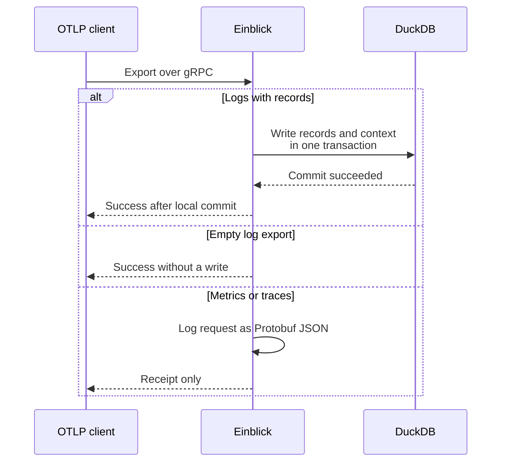

# 📥 Telemetry ingestion

[← Back to README](../README.md)

## 📡 Export telemetry

The receivers implement these standard OTLP/gRPC methods using upstream
OpenTelemetry definitions, including gzip:

| Signal | RPC |
| --- | --- |
| Logs | `opentelemetry.proto.collector.logs.v1.LogsService/Export` |
| Metrics | `opentelemetry.proto.collector.metrics.v1.MetricsService/Export` |
| Traces | `opentelemetry.proto.collector.trace.v1.TraceService/Export` |

The [development configuration](configuration.md) exposes all three on gRPC
port `12000`.

## ✅ What success means



Use [recent-log queries](queries.md) to read acknowledged logs. Look for
`component=logs` diagnostics for committed-record counts and write failures.
These diagnostics omit the incoming log payload. The request writes directly to
local storage and succeeds independently of background Parquet staging.

Metric and trace records are discarded after printing. Each request appears as one
logger message with its complete Protobuf JSON, including resource and scope
context. The `signal` field is `metrics` or `traces`. Empty requests print `{}`.

## 📝 Log support and delivery

The supported log contract is the decoded OTLP log schema pinned in [go.mod](../go.mod).
Storage preserves all its known log, resource and scope fields: typed bodies
and attributes, 64-bit integers, bytes, nested arrays/key-value lists, severity,
correlation IDs/flags, event names, dropped counts and schema URLs. Optional
resource/scope/body messages remain optional. Empty containers containing no
records do not create stored logs. Wire fields unknown to the pinned protobuf
are outside this support boundary.

The database stores typed Protobuf JSON, whose type tags and decimal-string
64-bit integers preserve the original values. Nanoseconds also have exact
`UBIGINT` columns. For event time, prefer a nonzero `Timestamp`, then a nonzero
`ObservedTimestamp`, then server receipt time. Both original timestamps remain
unchanged, and receipt time is stored separately. [OTel log data model](https://opentelemetry.io/docs/specs/otel/logs/data-model/)

Late and future timestamps are accepted without cutoffs, including the full
OTLP unsigned range. Local Parquet staging partitions logs by the UTC day of
the selected time. [Local Parquet staging](operations.md#-local-parquet-staging)

Repeated exports create additional records, including identical logs. There is
no deduplication index or time horizon. A lost response or ambiguous commit may
therefore lead to duplicates when the client retries. Success promises recovery
on the intact local data path, without protecting against volume loss. See
[recovery and compatibility](operations.md#-log-storage-and-recovery).

Keep the receiver's own OTLP log exporter disabled to avoid recursive log export.
Keep its metric and trace exporters pointed away from its own listener too.
Use `info` or `debug` logging to see receipts.

## 📨 Responses

| Request | Response |
| --- | --- |
| Valid log export | Empty response after local commit, without partial success. |
| Valid empty log request | Empty response, without a database write or partial success. |
| Log database, disk, statement or commit failure | `UNAVAILABLE`; retryable, with no successful acknowledgement. |
| Log content that cannot be represented by the pinned protobuf JSON encoder | `INVALID_ARGUMENT`; permanent failure. |
| Cancelled or expired log write | `CANCELLED` or `DEADLINE_EXCEEDED`; the outcome may be ambiguous if commit raced cancellation. |
| Valid metric/trace export, including an empty request | Empty receipt-only response without partial success. |
| Message larger than the configured wire or decompressed limit | `RESOURCE_EXHAUSTED`; split or reduce the request. |
| Malformed protobuf | `INTERNAL` from the shared gRPC decoder. |

Each log write succeeds or fails as a whole. Retry `UNAVAILABLE`. For
`RESOURCE_EXHAUSTED`, reduce the request size before resending. Failed writes
preserve existing records. [OTLP retry guidance](https://opentelemetry.io/docs/specs/otlp/)

## 🧪 Local client example

From the repository root, run:

```sh
make features tags=@printing
make features tags=@storage
```

The harness starts and stops the server. `@printing` covers metrics/traces;
`@storage` covers logs, including typed values, exact times, retries and restarts.
Inspect `test/reports/server.log` for metric/trace payloads and log diagnostics.
To select one signal, use its feature directory,
for example `make features feature=features/metrics/transport/grpc`.
See [development](development.md) for fixture details and the test harness.
