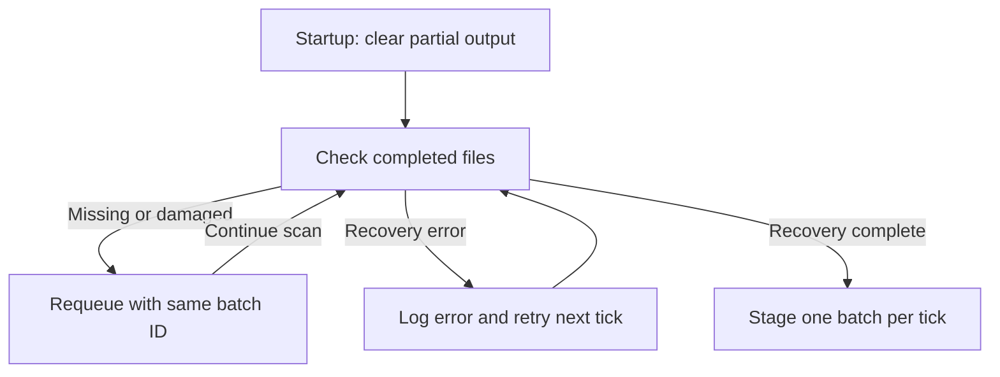

# 🛠️ Operations

[← Back to README](../README.md)

## 🩺 Health

| HTTP endpoint | Meaning |
| --- | --- |
| `/einblick/healthz` | External connectivity. |
| `/einblick/livez` | Process liveness, independent of the database. |
| `/einblick/readyz` | Database connectivity after startup recovery and migrations. |

The gRPC health service `einblick` uses the same database check as readiness.
Readiness does not establish free disk space or writable capacity.
With the development configuration:

```sh
curl --fail http://localhost:11000/einblick/readyz
```

## 🦆 Log storage and recovery

Set [the database path](configuration.md#-local-database) on a writable persistent
mount, for example `/data/recent.duckdb`. Retain the database, adjacent WAL and
spill files together across restarts. Stop the service before moving them.
A locked database file fails startup; the previous process must close it before
a replacement can open it for writing.

On restart, Einblick recovers DuckDB and applies pending migrations before
accepting traffic. Keep the volume to recover acknowledged logs. Staging
Parquet files leaves the source rows in DuckDB, where they continue to use space.

Disk write failures return retryable `UNAVAILABLE`. Restore writable capacity
and allow clients to retry. Repeated exports can produce duplicate records.
Look for `component=logs` diagnostics to distinguish committed exports from
storage failures.

Recent-log reads use the same recovered database; see
[query scope, pagination and failures](queries.md). A query failure does not
mean that previously acknowledged logs were discarded.

Pending schema migrations run automatically at startup. A failed migration
rolls back its own changes; earlier successful migrations remain applied.
Repair the reported cause and restart to retry. Do not manually advance recorded
versions to bypass an error.

An older binary refuses a database with a newer schema. There is no automatic
schema downgrade, so use a binary that supports the stored schema. Deleting the
database to bypass this check loses the retained logs.

## 🗃️ Local Parquet staging

When [enabled](configuration.md#-local-parquet-export), the exporter stages
completed log batches under `v1/signal=logs/day=YYYY-MM-DD/<batch-id>.parquet`
on its own quota-limited workspace. It uses the UTC day of the selected event
time. A late record can create another batch for the same day.



DuckDB retains the batch's exact members and logical digest. The exporter
verifies the written rows, renames the file, and records its byte checksum.
Recovery uses the retained rows to regenerate files while ingestion and recent
queries stay available.

When the staging mount fills, new export attempts fail and are retried at the
configured interval. Inspect `component=log_archive` diagnostics and available
workspace capacity. Increase or restore writable capacity and allow the next
export attempt to run. Keep the database and staging mount accessible at startup
when export is enabled. If the worker reports that the prepared workspace is
missing or changed, restore the original mount and its `v1` directory so the
worker can retry. After intentionally replacing the workspace, mount the
replacement and restart Einblick. Startup initializes the export directory on
the new filesystem so the worker can regenerate missing files from retained logs.
Transfer to R2 and source eviction are planned.

## 🚢 Deployment

Use the [project container build](development.md#-container-builds) to package
DuckDB's native runtime requirements. The data directory must be writable by
the service's runtime user.

Deployment settings live in the [application definitions](https://github.com/alexfalkowski/infraops/blob/master/area/apps/apps.hjson)
and [Einblick configuration](https://github.com/alexfalkowski/infraops/blob/master/area/apps/lean/einblick.yaml).
See [CircleCI](../.circleci/config.yml) for the release workflow.
