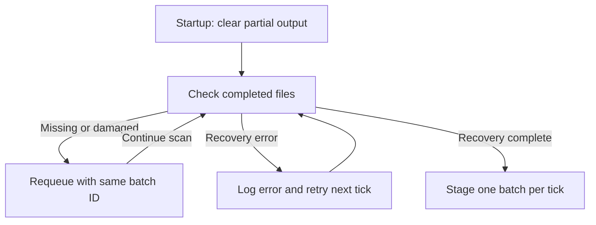

# 🛠️ Operations

[← Back to README](../README.md)

## 🩺 Health

| HTTP endpoint | Meaning |
| --- | --- |
| `/einblick/healthz` | External connectivity. |
| `/einblick/livez` | Process liveness, independent of the database. |
| `/einblick/readyz` | Database connectivity after startup recovery and migrations. |

The gRPC health service `einblick` uses the same database check as readiness.
Readiness does not establish free disk space or writable capacity.
With the development configuration:

```sh
curl --fail http://localhost:11000/einblick/readyz
```

## 🦆 Log storage and recovery

Set [the database path](configuration.md#-local-database) on a writable persistent
mount, for example `/data/recent.duckdb`. Retain the database, adjacent WAL and
spill files together across restarts. Stop the service before moving them.
A locked database file fails startup; the previous process must close it before
a replacement can open it for writing.

On restart, Einblick recovers DuckDB and applies pending migrations before
accepting traffic. Keep the volume to recover acknowledged logs. Staging
Parquet files leaves the source rows in DuckDB, where they continue to use space.

Disk write failures return retryable `UNAVAILABLE`. Restore writable capacity
and allow clients to retry. Repeated exports can produce duplicate records.
Look for `component=logs` diagnostics to distinguish committed exports from
storage failures.

Recent-log reads use the same recovered database; see
[query scope, pagination and failures](queries.md). A query failure does not
mean that previously acknowledged logs were discarded.

Pending schema migrations run automatically at startup. A failed migration
rolls back its own changes; earlier successful migrations remain applied.
Repair the reported cause and restart to retry. Do not manually advance recorded
versions to bypass an error.

An older binary refuses a database with a newer schema. There is no automatic
schema downgrade, so use a binary that supports the stored schema. Deleting the
database to bypass this check loses the retained logs.

## 🗃️ Local Parquet staging

When [enabled](configuration.md#-local-parquet-export), the exporter stages
completed log batches under `v1/signal=logs/day=YYYY-MM-DD/<batch-id>.parquet`
on its own quota-limited workspace. It uses the UTC day of the selected event
time. A late record can create another batch for the same day.



DuckDB retains the batch's exact members and logical digest. The exporter
verifies the written rows, renames the file, and records its byte checksum.
Recovery uses the retained rows to regenerate files while ingestion and recent
queries stay available.

When the staging mount fills, new export attempts fail and are retried at the
configured interval. Inspect `component=log_archive` diagnostics and available
workspace capacity. Increase or restore writable capacity and allow the next
export attempt to run. Keep the database and staging mount accessible at startup
when export is enabled. If the worker reports that the prepared workspace is
missing or changed, restore the original mount and its `v1` directory so the
worker can retry. After intentionally replacing the workspace, mount the
replacement and restart Einblick. Startup initializes the export directory on
the new filesystem so the worker can regenerate missing files from retained logs.

## ☁️ R2 publication and recovery

With [R2 configured](configuration.md#-r2-log-archives), the archive worker
publishes each closed batch to the same versioned key as its staged path.
OTLP acknowledges the local DuckDB commit. Publication and staging cleanup run
in the background. Queries use the local copy until its batch is evicted.

Before sending a file, the worker records its SHA-256 in DuckDB. R2 writes are
conditional on the key being absent. After upload or on retry, the worker
checks the object's metadata and streams its bytes to verify a recorded
checksum. This also recognizes a successful upload after restart, even if
staging is missing, cannot be regenerated, or has been regenerated with
different Parquet bytes. The worker can reconcile recorded upload attempts and
retry cleanup while local recovery is blocked by unreadable staging. New
exports and uploads resume after local recovery succeeds. Cleanup remains
pending after confirmation until the staged file has been removed or is absent.

For publication failures, inspect `component=log_archive` diagnostics, the
configured endpoint and bucket permissions, and the remaining staging
capacity. Unconfirmed batches retain their source rows. On each tick the worker
selects the eligible batch that has waited longest since creation or the last
attempt, so another batch can proceed while a failed upload, reconciliation, or
cleanup remains pending. The worker retries damaged staging in the same
publication rotation. A blocked repair leaves the export slot available for
new logs on other days. If the key contains conflicting bytes, investigate the
bucket and key ownership before changing the object. The worker preserves an
existing object and leaves the batch pending when verification fails. If
verification repeatedly times out, check that `archive.r2.client.timeout`
covers the full download. If publication succeeds but workspace cleanup fails,
restore staging access so the worker can reclaim the file.

The S3 client can continue a multipart abort after worker cancellation. A
stalled abort shares `archive.r2.client.timeout` with transfers, subject to the
client's one-minute abort cap. If it uses the remaining time in the application's
15-second shutdown budget, the process may exit before DuckDB closes cleanly.
Incomplete multipart uploads follow the bucket's incomplete-upload lifecycle
policy.

## 🔎 Historical log availability

When R2 is configured, the query API and Logs page discover Parquet objects in
the selected UTC days. A fresh database volume can query existing objects as
soon as it can reach the configured bucket. Keep the same bucket when reopening
a database that has evicted batches.

Historical reads include existing `v1` Parquet objects. The local migration
adds eviction state without changing archived files. Use the
[schema rollback guidance](#-log-storage-and-recovery) for the database volume.

When [local retention](configuration.md#-r2-log-archives) is enabled, the worker
downloads the confirmed object and verifies its checksum before deleting the
batch's local source rows. Count this GET in the
[R2 Class B operation budget](https://developers.cloudflare.com/r2/pricing/#class-b-operations).
Look for `local log archive eviction failed` under `component=log_archive` when
eligible batches stay local. A missing, unavailable or changed object leaves its
source rows in DuckDB. The worker continues with other eligible batches and
retries the blocked batch. A failed historical query reports unavailable storage.
Restore access to the bucket and retry the same absolute interval.

## 🚢 Deployment

Use the [project container build](development.md#-container-builds) to package
DuckDB's native runtime requirements. The data directory must be writable by
the service's runtime user.

Deployment settings live in the [application definitions](https://github.com/alexfalkowski/infraops/blob/master/area/apps/apps.hjson)
and [Einblick configuration](https://github.com/alexfalkowski/infraops/blob/master/area/apps/lean/einblick.yaml).
See [CircleCI](../.circleci/config.yml) for the release workflow.
