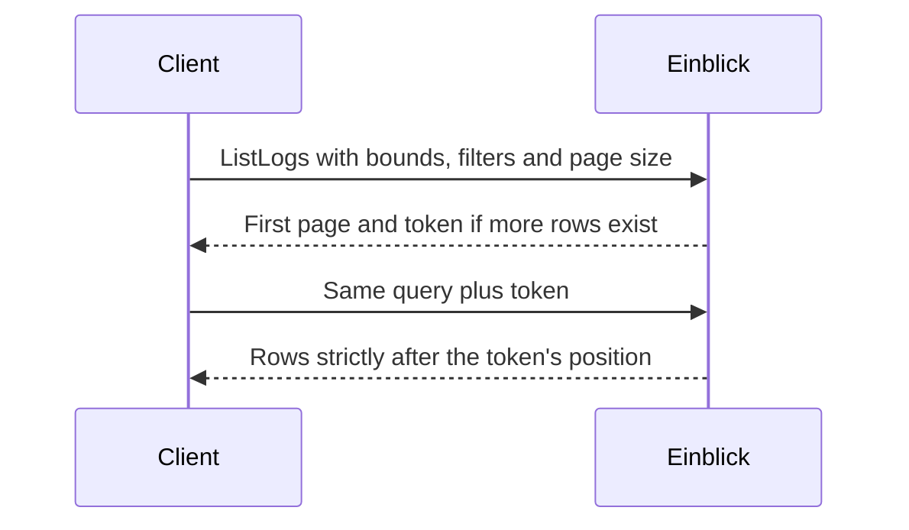

# 🔎 Log queries

[← Back to README](../README.md)

## 🖥️ Investigate logs in the browser

Open `http://localhost:11000/logs` with the development configuration.
The page opens on the last hour, or the configured query limit if it is shorter. Use the exact
service name, **Search messages**, a hexadecimal **Trace ID**, or severity to
narrow the results. An empty service filter includes unnamed services. A severity
choice matches one exact level (Debug, Info, Warn, Error, or Fatal), while
**All severities** includes every level. Matching message text is highlighted.

| Goal | Action |
| --- | --- |
| Search up to now | Choose a time preset. To apply filter edits, select **Search** or press Enter. A recent window advances to now each time you search or reload its URL. |
| Automatically refresh | Select **5s**, **10s**, or **15s** under **Auto-refresh**. Each refresh uses the applied filters and the rolling window from the address bar. Updates pause while log details are open or until a failed manual search is replaced by a successful one. Choose **Off** to stop automatic requests. The control starts at **Off** on a full page load. |
| Keep the exact interval | Choose **Next page**, clear the message search with **×** or **Clear search**, or search from an absolute-range bookmark. Clearing or paging retains the preset for the next **Search**. |
| Share or revisit a query | Copy the address bar URL, such as `/logs?window=15m`. Reloading or sharing it opens the first page for that duration up to now, even when you're viewing a later page. Use Back for the previous query or **Reset** to clear the filters and return to the latest window. |
| Inspect a log | Select a row or focus its message and press Enter. Use Escape or Close to return to it. On wide screens you can also click the backdrop. |
| Follow a trace ID | Open **Timing and IDs** and choose **Find related logs**. The search keeps the current range and other filters. |

The page offers **15 min**, **1 hour**, **24 hours**, **3 days**, and **7 days**
as allowed by the query limit. Below 15 minutes, **Recent** uses the configured
duration. To open a fixed interval, supply both `start_time` and `end_time` as
RFC 3339 timestamps, for example
`/logs?start_time=2026-11-19T11:00:00Z&end_time=2026-11-19T11:15:00Z`.
The page shows **Current range** on entry. Reload and Auto-refresh then use
the default duration.

The Logs page chooses where to search based on the selected time range.
Recent ranges covered by the current database volume can load during an R2
outage. If a search needs unavailable archive history, the page shows a
storage error. Choose a recent time preset or retry the same range after
the archive recovers.

The table shows UTC time to the second. When the producer omits event time,
the **Log details** summary labels the observation or receipt time used in its
place. The inspector fills the screen on narrow displays. It shows the full
message, available service, environment and time to receipt, and reported status
and duration for HTTP and gRPC request logs.
Expand **Attributes**, **Source**, or **Timing and IDs** for typed values,
resource and instrumentation details, exact timestamps, and copyable IDs.
Use the API for the original typed OTLP fields.

While **Loading logs…** is visible, you can edit filters and submit after the
query finishes. If htmx is unavailable, searches and pagination open full pages.
For no matches, try a longer preset or clear a filter. If a saved link fails,
choose **Open Logs**. When offered after a network or gateway error, **Try again**
resends the same inputs. A transport timeout appears in in-place updates and can
return an empty HTTP 504 on direct navigation.

The page supports English, German and Spanish with English fallback. Anyone who
can reach the HTTP route can query the same data as the API without a site login.

## 🔌 Query logs through the API

Use `einblick.v1.Service/ListLogs` over gRPC or
`POST /einblick.v1.Service/ListLogs` on the HTTP listener. Both use the
[versioned protobuf contract](../api/einblick/v1/service.proto). With R2
configured, queries combine local rows and archived Parquet for the selected
UTC days. Each page reads a batch from a single source, including during
publication and local eviction.

With the development configuration:

```sh
curl --fail http://localhost:11000/einblick.v1.Service/ListLogs \
  -H 'Content-Type: application/pbjson' \
  -H 'Accept: application/pbjson' \
  --data '{"startTime":"2026-11-19T11:04:05.123456789Z","endTime":"2026-11-19T11:04:05.123456799Z","service":"e01-client","pageSize":20}'
```

These absolute timestamp bounds match the synthetic log fixture; send logs
first or expect an empty page. Use `application/pbjson` for canonical protobuf
JSON, including RFC 3339 Timestamp strings. The shared HTTP RPC transport owns
content negotiation. Generated gRPC clients call `ListLogs` on port `12000`.

Regenerate Go and Ruby protobuf clients from the current schema and remove
`searchScope` from requests. The server chooses sources from the time bounds.
With R2 configured, a range that can include evicted logs also searches the
archive. If that history is unavailable, the API returns an error.

## 🕒 Time and filter scope

`start_time` and `end_time` are required protobuf Timestamps. In protobuf JSON
they are RFC 3339 strings with an explicit
`Z` or numeric timezone offset and up to nanosecond precision, following
[AIP-142](https://google.aip.dev/142). The interval includes `start_time` and
excludes `end_time`. Equivalent timezone representations select the same window
and can continue the same query. Returned times are normalized to UTC.

Query time follows the stored event-time policy: Timestamp, then
ObservedTimestamp, then server receipt time. Original timestamps remain in each
record. Bounds must fit the stored unsigned OTLP time range, from the Unix
epoch through the exclusive upper boundary `2554-07-21T23:34:33.709551616Z`.
The configured maximum range still applies. API clients supply both bounds.

All supplied filters must match:

| Parameter | Meaning |
| --- | --- |
| `service` | Exact string `service.name` resource attribute; omitted/empty selects all services. |
| `severity` | Exact OTLP severity suffix, such as `INFO`, `ERROR`, `WARN2` or `UNSPECIFIED`; omitted/empty selects all severities. This is not a minimum threshold. |
| `text` | Case-sensitive literal substring of string bodies only. Attributes, resource/scope fields and non-string bodies are outside text-search scope. SQL and wildcard characters remain literal. |
| `trace_id` | Exactly 32 hexadecimal characters, either case. It matches the record's trace ID; omitted/empty selects correlated and uncorrelated records. |
| `page_size` | Positive page size up to the configured maximum. Omitted or zero uses the maximum. |
| `page_token` | Opaque continuation token returned by the previous page. Keep all other parameters fixed, including the effective page size. |

## 📄 Results and pagination

The response contains `meta`, `logs` and `next_page_token`.
`meta` carries shared request metadata such as `request_id` and
`user_agent`. Each log includes a volume-local `id`, protobuf `event_time` and
`receive_time` Timestamps, and typed OTLP
`resource`, `scope` and `record` messages.

Canonical protobuf JSON uses camelCase field names: `startTime`, `endTime`,
`traceId`, `pageSize`, `pageToken`, `nextPageToken`, `eventTime` and `receiveTime`.
The decoder also accepts the proto's snake_case names shown in the filter table.
Response IDs and other 64-bit integers are decimal strings; bytes use base64.
Timestamps are UTC RFC 3339 strings preserving nanoseconds. These messages retain
the complete original typed content.
Trace/span IDs inside the original record also use protobuf JSON's base64 form;
the query filter accepts hexadecimal IDs.

Results sort by event time descending, then ID descending. Archive batch
identity breaks ties when different volumes reuse both values. Duplicate
exports remain separate records. Pass the returned token as `page_token` with
the same bounds, filters and effective page size.



Each page reads the committed records visible to that request. New records
behind the cursor can appear on later pages. Records ahead of it, including
equal-time arrivals with higher IDs, require a fresh query. Existing records
appear once across pages.

Archive-inclusive searches discover Parquet files for the remaining UTC
days in the selected range. A continuation excludes days newer than its
last returned record.

An empty token means exhaustion. Token size is independent of filter length.
An empty first page means no matches. Protobuf JSON omits default-valued fields, so
`logs` and `nextPageToken` can be absent; generated
clients expose an empty collection and empty string respectively.
There is no total-count query. Tokens survive service restarts and eviction
on the same volume while the archived objects remain available. Open a fresh
query after replacing the database volume. Clients must treat tokens as opaque.

## ⏱️ Bounds and failures

Required [query configuration](configuration.md#-recent-log-queries) limits page
size, selected range, timeout and active queries. The query timeout covers queue
waits, archive discovery and SQL work together. Cancellation propagates to
DuckDB. An active native object read can hold query resources until it returns.
The HTTP request timeout can end the client request earlier. Failed queries
return an error without a page.

| Outcome | HTTP result | gRPC result |
| --- | --- | --- |
| No matches | `200`, empty page. | `OK`, empty page. |
| Invalid bounds, filters, page size or token; changed pagination parameters | `400`. | `InvalidArgument`. |
| Cancelled request | `499` when the connection can still carry a response. | `Canceled`. |
| Deadline exceeded | `504`. | `DeadlineExceeded`. |
| Local or archive query failure, including an unavailable object store | `503`. | `Unavailable`. |

Errors use go-service's safe error responses. A disconnected client may receive
no response. No partial coverage or successful empty result is substituted for
a failed database read. `component=logs` diagnostics report query outcomes;
successful-query diagnostics include returned count and duration.
