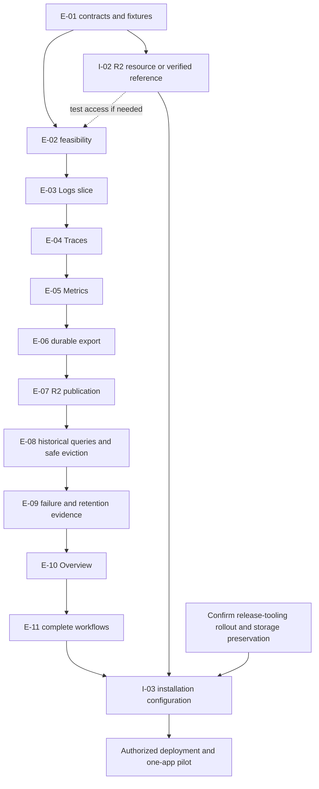

# Design review and staged implementation plan

**Reviewed:** Initial review on 2026-11-03; dependency follow-ups on 2026-11-04 against requirements revision 0.13.  
**Status:** B-01, I-01a, I-02's lifecycle capability, and release-image/consumer pin changes are delivered dependencies retired from future implementation. Release-tooling rollout is owner-reported in progress; execution evidence remains open. I-01b is superseded without implementation under D-018; I-02 retains bucket/reference and policy activation work. Einblick implementation packets remain unstarted. Section 11 tracks phase-local policies/evidence; technical proposals remain explicit.  
**Contract owner:** [requirements.md](requirements.md). This document explains risks, review units, and dependencies; it does not introduce a second product specification.  
**Owner direction:** Remove the proposed Recreate work so it is not implemented. Keep the existing rollout behavior and validate graceful DuckDB shutdown, one active writer and bounded startup/recovery. Do not begin service or infrastructure implementation.

**Delivery process:** Work through P0–P4 one phase at a time and one review packet at a time. The agent produces the selected change and an original patch; the human drives refinement and the PR stage. Preserve requirements + original patch + final PR + actual agent session ID, then inspect the path to the accepted result to improve `bin` skills through separate reviewed changes. Remind the human to capture the bundle at patch handoff and return it at phase close. The [phase feedback process](phase-feedback.md) owns capture, inspection, reminders and adoption; einblick implementation remains unstarted.

Keep the architecture and first-version scope. The future work is divided into bounded feasibility and implementation units below. No unit is activated by this document. The selected native stack, storage protocol, and metric queries still need their specified execution evidence. The existing P0–P4 milestones remain useful, but each is too large to use as a single implementation task or PR.

Use small independent repository reviews with explicit integration gates, including confirmation of the delivered release-image/consumer changes and storage-preserving execution before storage activation. Deliver a working Logs path early, then traces and metrics in separate changes. Prove recovery and archival before completing the dashboard and starting the one-application pilot. All three signals remain required for v1.

Sections 2–4 explain the review and delivery structure. Sections 7–10 supply the future task scopes, decision deadlines, repository interfaces, and completion record. Use [requirements section 1.1](requirements.md#11-inherit-standards-and-derive-routine-details) to inherit OTel contracts and derive routine details from supported repository patterns. Section 11 is a phase-local follow-up list; it does not require all later-phase designs before P0. Feasibility results and unresolved material choices remain explicit.

## 1. Review scope and evidence

Inspected the current README, agent guidance, complete requirements and acceptance matrix, catalog example, prototype source/generated preview, smoke harness, recorded results, and Overview screenshot. Ran the handoff integrity check. Inspected the relevant local `bin` and `infraops` instructions, Makefiles, CI, build scripts, application schema/resources, and existing Pulumi mock test shape. Sibling inspection establishes integration surfaces, not an audit of those repositories or deployed infrastructure.

Source baselines were `bin` commit `9372832ac8d265747e347facf9d6a58b7af53ea5` and `infraops` commit `d33c8e4c489121da9132fc203ef070929e07abb8`; both working trees were clean when inspected. This planning folder has no Git repository. The go-service native metric profile and actual emitted payloads were not recaptured in this review and remain feasibility work.

The 2026-11-04 CGO follow-up inspected clean `bin` commit `e8ad603613179460aea3096a58cf85e09b9b0992` (PR #660), reran shell/Dockerfile lint, and checked service-target routing and invalid-mode rejection. The owner also confirms that `duckdb-go` was built and successfully run in an ARM image on an M5 Mac while developing the feature. This retires B-01's capability work and trial; it does not establish einblick's complete release packaging. The [verification record](evidence/bin-cgo-verification.md) separates observed checks, owner-reported execution, the external PR's recorded checks, remaining integration gates, and missing original-PR feedback inputs.

The original storage follow-up inspected infraops implementation commit `342ca738ac0d618341389bfc9644c0e3b4831b66`, retiring I-01a. The [storage record](evidence/infraops-storage-verification.md) remains a point-in-time record. The latest [dependency refresh](evidence/r2-release-verification.md) verifies storage PR #3763, R2 expiration PR #3764/tag v2.617.0, docker PR #1818's release 8.48/bump 2.617.0, and all four deployment-pipeline source pins. It supersedes the earlier missing-lifecycle/old-release-pin status. Rollout is owner-reported in progress; actual release/storage/CSI and R2 behavior were not exercised. I-01b was subsequently superseded by the owner in D-018; the [rollout scope record](evidence/rollout-scope-update.md) supersedes that portion of the earlier evidence. Original implementation patch/session comparisons and final CI evidence remain separate feedback inputs.

Primary external documentation was checked for OTLP retry/partial-success behavior, metric identity/temporality, DuckDB driver binding and extension packaging, disk reclamation, and R2 consistency/lifecycle behavior. Documentation checks are not pinned-version runtime tests.

**Confidence: 90% in the review breakdown and sequencing**, based on the current contracts, source inspection, and the challenge pass in section 6. No confidence claim is made for runtime feasibility or pilot readiness.

## 2. Findings to resolve at the relevant gate

### R-01 — Prove the native release path before committing to the backend implementation

**Priority:** First feasibility gate. **References:** D-004/D-005, DEP-001–DEP-003, DEP-009; O-010; P0.

The selected driver, bundled engine, extensions, runtime libraries, and platform builds form one deliverable. `bin` PR #660 now supplies the required shared opt-in: `static=0` enables CGO, removes forced static linking and selects `gcr.io/distroless/cc-debian13`, matching the Trixie builder's Debian generation. The default remains CGO-disabled/static. The owner confirms a successful ARM `duckdb-go` image build/run on an M5 Mac, covering the native capability trial. E-02 still validates einblick's final pinned stack, extensions and required-platform coverage. [Inspected Dockerfile](https://github.com/alexfalkowski/bin/blob/e8ad603613179460aea3096a58cf85e09b9b0992/build/docker/go/Dockerfile), [build helper](https://github.com/alexfalkowski/bin/blob/e8ad603613179460aea3096a58cf85e09b9b0992/build/docker/build).

The upstream driver documents microsecond conversion for ordinary `time.Time` binding. DuckDB extensions are tied to engine version and platform. Therefore the feasibility sample must preserve nanoseconds through the actual Go → DuckDB → Parquet → Go path, and load packaged remote-read support in the actual non-root, read-only-root image. A host CLI demonstration is insufficient. [Driver documentation](https://github.com/duckdb/duckdb-go#notes-and-faqs), [extension compatibility](https://duckdb.org/docs/2.0/extensions/extension_distribution#binary-compatibility).

**Review result needed:** In E-02, consume an immutable `bin` revision containing PR #660 and record exact dependency/image pins, required platform matrix, typed-value round-trip results, restart evidence, extension inventory/licenses, and measured process memory. Reopen shared tooling only if the actual selected stack demonstrates a missing capability; no further shared CGO change is currently planned.

### R-02 — Set the telemetry and query contracts before the three signal implementations diverge

**Priority:** Before storage schema and ingestion. **References:** DAT-001–DAT-008, ING-002–ING-005, QRY-001–QRY-006; O-004–O-006/O-012.

The requirements correctly leave several policies open. Implementation must make them explicit: supported OTLP shapes, event-time selection/fallback per signal, late/future input, typed attributes and large integers, duplicate/conflict behavior, metric stream identity, and the response to unsupported content. These are data-contract decisions, not tuning values.

A concrete failure case is a metric export committed locally just before its acknowledgement is lost. The retry must have documented behavior even after the first copy has been archived and evicted. Stable archive IDs solve export retries, not this record-level duplication. Specify the supported duplicate horizon and behavior outside it; do not quietly introduce an indefinitely growing deduplication index. Define what happens when identical identities carry conflicting content.

OTLP partial-success responses are not retried by clients, whereas suitable temporary failures can be retried. Define transaction and response behavior so disk pressure does not accidentally become permanent partial rejection. Commit failure must not produce success. [OTLP response and retry contract](https://opentelemetry.io/docs/specs/otlp/#otlpgrpc-response).

For log pagination, agree on an ordering tie-breaker and what “stable” means when delayed records arrive. Proposed approach: fixed absolute time bounds, keyset pagination, and a receipt boundary carried by the cursor; document cursor expiry and archive/local transitions. Define trace duration/error selection and bounded cross-service lookup scope as well. These are proposals to resolve under the existing open decisions.

**Review result needed:** A short support/policy table, example fixed query inputs/results, and sanitized fixtures from pinned go-service instrumentation. Include nanosecond timestamps, typed bodies, missing correlation, retries, and unsupported shapes. Keep synthetic edge cases distinguishable from captured instrumentation evidence.

### R-03 — Review archival ownership as a protocol before implementing its workers

**Priority:** Before archival code. **References:** STO-002–STO-009/STO-011, QRY-008/QRY-010; AC-007–AC-011/AC-019.

The desired invariant is clear; the mechanics are not yet designed. A query must keep a valid data source while a batch moves from local rows to a remote object and local rows are removed. “Query local plus R2 and deduplicate” does not by itself establish that invariant.

Review a state table covering batch closure, completed file, upload, verified remote publication, and safe eviction. State which transitions commit in DuckDB, how each interrupted transition recovers, how queries select one source per batch, and how in-use rows/files survive cleanup. Include upload success followed by process death before local success marking. If a derivative file is rebuilt, do not assume its Parquet bytes will be identical; define how expected content identity is verified.

R2 documents strong object reads and listings, but that does not make a DuckDB transaction and an object-store operation atomic together. The cross-store ownership rule is still einblick's responsibility. [R2 consistency model](https://developers.cloudflare.com/r2/reference/consistency/).

**Review result needed:** Transition/recovery table plus query-ownership examples. Then demonstrate AC-007 through the supported query boundary during actual upload/eviction, rather than testing worker call order.

### R-04 — Treat metrics as a distinct correctness milestone

**Priority:** Before Overview charts. **References:** DAT-005, QRY-005/QRY-006/QRY-013, CAT-005; AC-006/AC-024.

The dashboard vocabulary is useful, but neither the prototype curves nor the Grafana Prometheus queries establish the native OTLP mappings. Metric stream identity, temporality, reset/start times, missing values, histogram boundary compatibility, and multi-instance aggregation affect whether a visually plausible chart is correct. OpenTelemetry distinguishes these properties explicitly. [Metric data model](https://opentelemetry.io/docs/specs/otel/metrics/data-model/).

**Review result needed:** A panel mapping table from captured go-service payloads, with hand-checkable expected rates and histogram results. Cover lookback across midnight/local/archive boundaries, restarts, gaps, duplicate points, two instances, and incompatible buckets. Compute quantiles from compatible aggregated distributions; preserve no-data/stale/error states. Ship the query results before adding the complete Overview presentation.

### R-05 — Enforce resource bounds from the first working data path

**Priority:** P0 baseline and every subsequent slice. **References:** ING-004/ING-005, QRY-009, OPS-001–OPS-007, STO-011/STO-014; O-008.

The requirements already recognize whole-process memory. Acceptance should exercise ingestion, a historical query, export, and upload together. Row limits alone do not bound scan work. A request limit must cover the actual gRPC decode/decompression path, and query cancellation must release native and remote work. Record the chosen admission/concurrency limits, timeout, search range, chart point limit, and workspace allowance before their implementation becomes an accidental default.

Do not equate deleted rows with immediately available filesystem capacity. Measure repeated ingest/archive/evict/checkpoint cycles, database/WAL allocation, spill files, completed exports, and pinned query resources. DuckDB's documentation distinguishes checkpoint reclamation from `VACUUM`; actual behavior must be checked on the selected engine. [DuckDB memory limits](https://duckdb.org/docs/2.0/guides/performance/oom), [disk reclamation](https://duckdb.org/docs/2.0/operations_manual/footprint_of_duckdb/reclaiming_space).

**Review result needed:** A reproducible constrained run with measured RSS/container memory, disk/workspace high-water marks, and successful backpressure/recovery. Initial numbers are test budgets, refined by the pilot, not capacity promises. Keep enough disk reserve for committing metadata and recovering/exporting the backlog.

### R-06 — Separate infrastructure capability from enabling the installation

**Priority:** Establish interface during P0; integrate before pilot. **References:** DEP-004–DEP-010, ING-007, OPS-007; O-002/O-007/O-008.

Infraops now provides optional `storage` with required `capacity`/`path` and optional `profile`. It creates a protected `<app>-data` filesystem PVC and writable mount; omitted storage retains existing behavior. Keep the existing rolling-update behavior and disruption budget; D-018 removes the proposed rollout capability change. Validate graceful shutdown and bounded database-lock handoff in the service instead. Reuse the existing HTTP/gRPC services and browser ingress where suitable. [Application schema](https://github.com/alexfalkowski/infraops/blob/342ca738ac0d618341389bfc9644c0e3b4831b66/api/infraops/v2/service.proto), [storage](https://github.com/alexfalkowski/infraops/blob/342ca738ac0d618341389bfc9644c0e3b4831b66/internal/app/storage.go), [deployment](https://github.com/alexfalkowski/infraops/blob/342ca738ac0d618341389bfc9644c0e3b4831b66/internal/app/deployment.go).

**Remaining result needed:** I-03's installation configuration and actual runtime/CSI validation using the existing rolling-update path. Select capacity/profile, data/workspace paths, listener/probe alignment, secrets, shutdown/startup behavior and measured budgets. Verify that delayed graceful shutdown and overlapping replacement startup preserve one active DuckDB writer and readiness after recovery. Release-image and consumer source changes are delivered; before storage activation confirm actual execution after rollout and demonstrate storage-preserving releases. See the [current dependency evidence](evidence/r2-release-verification.md) and [owner rollout decision](evidence/rollout-scope-update.md).

The delivered R2 bucket and optional expiration capability can be reused without a public custom domain. Bucket existence, private access, permissions, lifecycle ownership and activation remain deployment work. Object-age deletion is asynchronous and does not enforce strict event-age retention; O-003 remains open. See the [delivered interface](evidence/r2-release-verification.md) and [R2 lifecycle behavior](https://developers.cloudflare.com/r2/buckets/object-lifecycles/).

### R-07 — Keep prototype success separate from frontend acceptance

**Priority:** Before the MVC workflow reviews. **References:** WEB-003/WEB-015/WEB-016, CAT-001/CAT-006; AC-023–AC-025.

The prototype demonstrates the main investigation flow, charts, bounded log pages, and a mobile layout. Its source also shows unfinished acceptance details: `hashState`/`readHash` omit search/severity/error filters; navigation replaces history; table/span row interactions lack keyboard equivalents; only HTTP-only and dual-protocol services are illustrated; status values are synthetic. These are prototype coverage gaps, not evidence of backend failures.

The prototype is disposable and will be replaced by the MVC implementation. Two known interaction defects remain intentionally unfixed in the preview: Overview's recent-trace list ignores the selected instance/time scope, and automatic refresh drops search focus and selection in Logs and Traces. In the final MVC views, filter Overview traces to the active investigation scope and preserve search focus and caret/selection across automatic refresh. Verify both behaviors through browser scenarios during the relevant frontend reviews.

**Review result needed:** During MVC implementation, verify URL round-tripping and return navigation, keyboard detail/span access, gRPC-only and worker catalog entries, uncatalogued telemetry queries, missing correlation, bounded large traces, and visible stale/partial/error/cancelled states. The log search placeholder mentions attributes, while the mock searches message/trace/instance text; define and label the real search scope consistently. The prototype need not grow into a second application to prove these behaviors.

### R-08 — Correct acceptance sequencing and distinguish partial from full completion

**Priority:** Before assigning implementation tasks. **References:** P1/P2; AC-003/AC-005/AC-008/AC-013/AC-017/AC-026.

Revision 0.3's P1 exit includes AC-003, whose scenario requires archival even though archival begins in P2. AC-005 also needs both local and archived midnight cases by final acceptance. Split evidence by milestone while preserving each acceptance ID: local portions in P1, archive round-trip and historical portions in P2. Prove local committed-record recovery in P1. Enforce query bounds as queries appear, rather than waiting for frontend completion. Design schema migration/rollback when pinning the schema; repeat its full acceptance before pilot.

**Review result needed:** Each task states which portions of an acceptance scenario it demonstrates. Only mark the full scenario passed when all applicable portions have run. AC-014 remains deferred. Dependency review and binary measurements do not by themselves pass the actual-R2 portions of AC-026.

## 3. Independent repository tracks

Each remaining row below is a separate future review unit, initially sized for one PR. Split further when the reviewer would need to assess two different invariants. Keep implementation, relevant evidence, and documentation together. No line-count target substitutes for a coherent behavior boundary. B-01, I-01a, I-02's lifecycle capability and release-image/consumer source updates are retained as delivered dependencies. Select only remaining work; einblick implementation packets are unstarted.

### Service track: einblick

| Unit | Phase | Deliverable and review question | Evidence to close the unit |
| --- | --- | --- | --- |
| E-01 | P0 | Reference applicable OTel contracts, inspect supported source conventions and identify the few backend exceptions/inputs needed by feasibility. Resolve O-001/O-010 as needed; inventory instruments and representative fixture needs. | Short references/version/source inventory, supported-subset differences, platform/runtime inputs and relevant unresolved backend policies. Reuse inherited semantics; exact schemas/queries and later archive design can accompany their selected packets. No full telemetry specification or later-phase design package is required. |
| E-02 | P0 | Minimal go-service baseline plus native/R2 feasibility harness. Pin only dependencies that pass their gates. Can the intended stack preserve and query representative data for all three signals? | Actual typed/nanosecond Parquet round-trip, restart, packaged extension/image run, and constrained-memory baseline. Actual R2 transfer/reconciliation/cancellation/pagination/multipart evidence and separate DuckDB remote reads; dependency/license and linked-binary measurements for AC-026. Consume the existing `static=0` interface from bin PR #660 for the final release path. |
| E-03 | P1 | Standard log intake → local commit → fixed log query → thin MVC Logs page. Include admission bounds, independent diagnostics, and startup recovery. Does a successful acknowledgement survive restart and become useful to a user? | Log portions of AC-001/AC-002/AC-003, AC-004, local-record portion of AC-008; backend query-bound portions of AC-013. No full acceptance claim for three-signal or archive scenarios yet. |
| E-04 | P1 | Trace intake, local search/lookup, and basic inspectable trace view using the established path. Are correlation, lookup scope, and bounded trace details correct? | Trace portions of AC-001–AC-003, local cross-service/midnight AC-005, recovery and context examples. Keep large/incomplete traces usable and explicit. |
| E-05 | P1 | Metric intake and fixed metric queries, reviewed separately from the full dashboard. Are rates, units, resets, and distributions correct? | Metric portions of AC-001–AC-003, AC-006, metric profile/expected values for AC-024; local recovery for all signals. Close remaining P1 support/response cases. |
| E-06 | P2 | Durable closed-batch/export jobs and complete local Parquet files for all signals. Can any interrupted local export be rebuilt without changing its source record set? | AC-003 archive-format round-trip, export interruption portion of AC-009, local pending-job portion of AC-008. No local eviction before remote confirmation exists. |
| E-07 | P2 | R2 publication and ambiguous-outcome reconciliation, retaining local source rows. Are accepted records retained and is one batch published once logically? | Remote portions of AC-008/AC-009, transfer bounds and AC-026 integration evidence. Local eviction waits for E-08's working historical reads and ownership rule. |
| E-08 | P2 | Unified local/archive fixed queries, safe eviction, day-prefix discovery, and rebuild. Does a query retain coverage across upload and eviction? | AC-007, AC-011, eviction/cleanup portions of AC-019, archived AC-003/AC-005, metric lookback across the boundary, historical cancellation/failure cases in AC-013/AC-016. |
| E-09 | P2 | Retention and bounded failure/recovery exercise. Does the service preserve acknowledged data through an R2 outage and recover after backpressure? | AC-010/AC-012/AC-019, concurrent workload resource report, repeated disk cycles, backlog drain and health behavior. Resolve O-003 before enabling retention. |
| E-10 | P3 | Catalog-driven Overview and protocol-specific panels over verified metric queries. Does adding an entry produce correct charts without query authoring? | AC-023/AC-024, worker/gRPC-only cases, units/aggregation labels, server-side chart limits, honest no-data/zero/stale states. |
| E-11 | P3 | Complete the connected MVC workflows and operator status. Do shared links, keyboard navigation, and investigation context work with real query results? | Full AC-013/AC-015/AC-016/AC-022/AC-025, plus remaining frontend portions of AC-023/AC-024. Embedded licensed assets, no site login/session subsystem. |

E-03's thin Logs UI and E-04's trace details provide early end-to-end review; P3 remains responsible for the complete UX contract. Reuse one MVC implementation. E-02's harness validates feasibility; it does not stand in for the service-boundary recovery/query scenarios in later units.

Use these smaller default packets within the existing unit IDs; the parent unit closes only after its applicable evidence is complete:

| Packet | Principal review question / result |
| --- | --- |
| E-02a | Does the pinned native path preserve representative typed/nanosecond data through persistent DuckDB/Parquet and restart on required release platforms? |
| E-02b | Do the selected lean client and DuckDB remote reads meet the actual-R2 transfer, cancellation, reconciliation and resource requirements? |
| E-02c | Does the minimal supported go-service composition integrate the validated dependencies/configuration with a recorded command/evidence baseline? |
| E-03a | Does bounded log ingestion commit before acknowledgement and expose stable fixed queries with recovery, response and cancellation evidence? |
| E-03b | Does a thin MVC Logs view use that established query path and render content safely? |

I-01a is delivered and I-01b is superseded without implementation; both are excluded from this future-packet list; the infrastructure section below owns its retained interface reference. Run remaining sub-packets serially in their parent phase. Derive their schema/config/query details from the standards and repository sources, and document them with the patch. Preserve a requirements/patch/PR/session bundle for each reviewable sub-packet.

### Shared build dependency: bin (delivered externally)

**B-01 — Opt-in native service image path: retired from future implementation on 2026-11-04.** The shared capability was delivered independently by [bin PR #660](https://github.com/alexfalkowski/bin/pull/660), commit `e8ad603613179460aea3096a58cf85e09b9b0992`. Use `make build-docker platform=<amd64|arm64> static=0`; the same option applies to `test-docker` and `release-docker`. It selects CGO, non-forced-static linking and the Debian 13 C/C++ runtime together; omitted or `static=1` builds retain the existing defaults. The previously proposed native-target versus Dockerfile-override comparison is superseded by this delivered interface.

**Verified scope:** Source/default inspection, current `make scripts-lint` and `make docker-lint`, service-fragment dry-runs from a supported consumer, executed invalid-mode rejection, and the owner's confirmation of a successful ARM `duckdb-go` image build/run on an M5 Mac. See the [verification record](evidence/bin-cgo-verification.md). The local commit message states that no downstream image was built/run; the owner's clarification supplies additional execution evidence. Exact commands, dependency pins and extension coverage from that run have not been retained in this bundle; amd64 execution is not recorded. The capability trial is complete and is not scheduled again as new work.

**Remaining owner: E-02a.** Pin the consuming `bin` revision and opt this service in; keep the DuckDB driver/engine, extension versions/licenses and any additional native libraries owned by einblick. Validate the final einblick image: required-platform coverage, packaged extension loading without runtime internet installation, scanner results, non-root/read-only-root operation and constrained memory. Reuse applicable evidence from the successful capability trial when its commands/pins/platforms are available. The current Dockerfile copies the service executable only; final extension packaging still needs proof. Retain the existing manifest contract until O-010 is resolved. No coordinated update of ordinary consumers, new bin PR, or repeated generic CGO trial is scheduled by B-01. Missing original PR requirements/patch/session evidence remains a feedback limitation rather than a reason to reimplement the capability.

### Infrastructure track: infraops

**I-01a — Persistent application storage: delivered; retired from future implementation.** PR #3763, commit `a2c6f88f081e761fbef71aef05cf3215b73e90d6`, provides `storage.capacity`, `storage.path` and optional `storage.profile`; protected `<app>-data` claims, writable mounts and existing non-root/read-only-root settings are wired. Omitted profile uses the cluster default, an empty profile requests no StorageClass, and a named profile selects that existing class. I-01's storage capability is delivered; its former rollout sub-packet I-01b is superseded without implementation. Actual installation/runtime acceptance remains open. See the [original storage record](evidence/infraops-storage-verification.md) and [current dependency refresh](evidence/r2-release-verification.md) for provenance, lifecycle semantics and evidence limits. No new PVC/mount implementation is scheduled.

**I-01b — Superseded without implementation by owner decision D-018 (revision 0.13).** Remove the proposed Recreate capability and per-application strategy selector from scope. Do not change the shared rollout default. Use the existing one-replica rolling-update path and validate graceful DuckDB shutdown, bounded lock handling, single-writer access and readiness after recovery. This validation belongs to the service lifecycle and P4 integration; it does not create another infrastructure implementation packet. See the [owner decision record](evidence/rollout-scope-update.md).

**I-02 lifecycle capability — delivered; retired from future implementation.** Infraops PR #3764, `ded49c5c48800ec121b400a9f3490ae795c450a6`/`v2.617.0`, adds optional `expiration` using positive whole-second Go durations (`168h`/`24h`, not `7d`). It owns the complete lifecycle rule set, expires all objects by object age, and retains seven-day incomplete multipart cleanup. Infraops documents that removing a previously applied value leaves remote rules active with the pinned provider; follow its explicit remote disable/remove procedure. Bucket/reference configuration and activation remain I-02 work; O-003 remains open. See the [dependency refresh](evidence/r2-release-verification.md).

| Unit | Phase | Scope | Review evidence and dependency |
| --- | --- | --- | --- |
| I-02 | P0 test resource if needed; P4 installation | Remaining private R2 bucket/reference and selected retention configuration/activation. Reuse delivered bucket and optional expiration support; do not repeat lifecycle-capability implementation. Keep bucket/secret ownership explicit. | CF resource checks and `cf` preview when authorized/configured. No public custom domain for the archive. Actual test-R2 access is needed by E-02; use a verified test bucket or separately authorize provisioning one. Before lifecycle activation, review existing rules and the change/removal contract; actual deletion remains live evidence. |
| I-03 | P4 | Add einblick's installation configuration: approved identity, immutable image, delivered storage configuration, one replica with existing rolling updates, HTTP/internal gRPC wiring, R2 secret sources, ingestion TLS/trust, probes, shutdown and measured budgets. | `apps`/`cf` previews as applicable; actual AC-018 storage/rollout/runtime evidence follows deployment. Requires I-02, the pilot-ready service and storage-aware release tooling adopted by every configuration-writing consumer. Any missing resource/probe tuning capability is a preceding scoped change. |

I-01a is available and I-01b is superseded; I-03 consumes storage with the existing rollout behavior. The docker release-image change and the four existing deployment-pipeline pins are delivered; do not schedule them again. Before I-03 adds `storage`, confirm actual use of release 8.48/bump 2.617.0 or a newer verified version after the owner-reported rollout, and demonstrate that releases preserve all storage settings, including optional-profile presence. I-02 now reuses delivered lifecycle support for the separately selected bucket/reference and policy activation. Keep schema comments and generated code aligned in any remaining capability changes.

Inspected infraops commands include `make dep`, `make package=internal/app specs`, `make lint`, `make api-lint`, `make api-breaking`, `make sec`, and `make area=<apps|cf> pulumi-preview`. Use the affected package/area and owning CI; dependency/schema tools and previews may require network, provider credentials, and remote state. Pulumi preview is planning evidence, not a deployment. Main-branch area workflows perform updates, so review the automatic effect before merging activating configuration.

## 4. Dependency and review order



The diagram shows remaining prerequisites, not parallel execution; delivered capability/image/pin implementation is omitted. Follow the serial phase/packet order in [the phase feedback process](phase-feedback.md#1-one-active-phase-and-review-packet). Complete and review the active phase and its feedback disposition before selecting the next. Prepare only the selected repository packet. P0 records delivered interfaces and test-R2 access; P4 completes rollout confirmation, storage-preserving release evidence and installation integration. Do not treat synthetic results as data correctness evidence.

At each boundary, provide:

- The concrete new behavior, requirement IDs, and exact acceptance portions exercised.
- A short demonstration or reproducible command through the repository's established harness, with actual results and measurements.
- Required dependency versions and any preceding PR/release, plus remaining limitations.
- For storage/infra changes, the effect of interruption, ordinary restart, upgrade, and rollback.
- The retained first requirements draft and requirements used, original patch/base revision, actual agent session IDs and accessible record if available, human-driven final PR/revisions, review corrections/rationale, skills revision used, and phase feedback/adoption record.

Review before expanding to the next behavior. Failed feasibility should produce evidence and a scoped decision, not a second storage engine or a growing abstraction framework.

## 5. Future pilot scope

After E-01–E-11 and the independent infrastructure/build work, review the supported upgrade/recovery path (AC-017), architectural constraints (AC-021), all active acceptance evidence, and the runbook. Deploy only within an explicitly authorized rollout task. Then enable one client application with explicit log/metric/trace exporter, interval, sampling, and TLS/authentication configuration. Its configuration change is a separate client-owned review or an infraops runtime-config change, according to the actual owner.

The pilot closes AC-020 and refines O-008 using observed ingestion rates, retained bytes, peak process memory, disk growth, archive lag, outage reserve, backlog recovery, and representative recent/historical query timings. Verify replacement with the intact volume and archived-only recovery on a fresh volume. Document single-instance downtime and loss of unarchived data after permanent volume loss. Broader rollout is a later decision.

The pilot is a future task, not the continuation of this planning request. Review installation configuration, runtime validation, and the client enablement change as separate results. No deployment or application exporter change is part of preparing this handoff.

## 6. Challenge pass and validation limits

The review did not identify evidence requiring a change to the agreed engine, single-instance design, OTLP/gRPC transport, immutable Parquet/R2 archive, lightweight MVC stack, no-AWS-Go-SDK constraint, or deferred site authentication. Their implementation feasibility remains unproven. The concerns above mostly refine existing open decisions and acceptance evidence, rather than adding product scope.

Checked alternative interpretations: batch deduplication is distinct from record retry semantics; R2 consistency does not resolve local/remote transaction ownership; no site login is an accepted v1 choice; existing Service/Ingress/R2 capabilities should be reused; prototype omissions do not establish service bugs. E-02 must validate all three signals before the logs-first implementation order is accepted as a practical route.

Checks recorded from the design-review pass (these are not claims that the browser or sibling checks were rerun during a later documentation-only update):

- `python3 tools/check_handoff.py`: passed; 90 requirements and 26 acceptance IDs preserved, generated preview matches its source, and no external preview assets.
- `make help` in `bin` and `infraops`: succeeded; used for command discovery, not implementation validation.
- `node prototype/smoke.mjs` and its documented `CHROME_NO_SANDBOX=1` variant: both failed before browser connection with “Chrome did not expose CDP.” A Chrome diagnostic using a temporary profile exited on `setsockopt: Operation not permitted`. Classify this as an environment/browser-launch limitation; no current browser interaction pass is claimed. The existing 16-check report is earlier evidence only.

No Go service tests, CGO builds, linked-binary measurements, R2 operations, Pulumi previews/updates, deployment, or live instrumentation capture were performed. No sibling repository was changed. Documentation work needs integrity checks, not invented backend tests. Refactor assessment: no production/test changes; no refactor required.

## 7. Future task scopes and entry conditions

**Execution state: einblick implementation packets are unstarted. Delivered CGO/storage/lifecycle and release-image/consumer source changes are retired from future implementation; release-tooling rollout is owner-reported in progress.** A task must name its remaining packet and writable repository. Reading sibling conventions does not authorize changing those siblings. Stop at the selected review boundary; dependencies becoming available do not activate another task. E-02 consumes bin PR #660; I-03 consumes delivered storage after rollout confirmation and release-preservation evidence; I-01b is superseded and is not a prerequisite. Routine details follow the owning repository's instructions.

The output/evidence column in section 3 is the completion contract for each unit. The following table adds exact entry conditions and scope boundaries. Existing requirement IDs continue to own product behavior.

| Unit | Entry conditions | Writable scope and required result | Boundary of the review |
| --- | --- | --- | --- |
| E-01 | A later task explicitly selects source/contract preparation. | `einblick`: recheck relevant instrumentation/conventions read-only; record references/versions, support differences, fixture needs and platform/runtime inputs. Use inherited semantics; record actual owner decisions only where material. | No production backend or resource changes. Provide the inputs needed by E-02; do not require all later schema/query/archive details before feasibility. |
| I-02 | E-01 identifies test archive needs and resource ownership; actual access/provisioning scope is known. Lifecycle capability is delivered. | `infraops` if resource configuration is needed: identify a usable private test bucket/reference for E-02. Final bucket/retention configuration reuses optional `expiration` after the policy chosen by E-09. | Do not repeat lifecycle implementation or require production policy selection for a test bucket. Separate resource definitions/previews from activation. Review complete-rule ownership and explicit remote-rule disabling. No credentials are copied into this handoff. |
| E-02 | E-01 inputs; consume bin commit `e8ad603613179460aea3096a58cf85e09b9b0992` or a reviewed later revision containing PR #660 for E-02a. Actual test-R2 access is required for E-02b; E-02c consumes the reviewed native/R2 results. | `einblick`: minimal module/config/command baseline, consuming bin pin and `static=0` configuration, pinned native dependencies/extensions, and bounded feasibility fixtures/harness. Prove local/Parquet precision, restart, release-image execution, R2 operations, remote reads, memory, and dependency footprint. | No complete ingestion service, dashboard, deployment, second storage engine, or fallback S3 implementation. An unavailable resource blocks the sub-packet needing it; incomplete actual-R2/platform evidence still prevents passing P0. |
| E-03 | E-02 feasibility gates passed; O-004/O-005/O-006 have the log policies needed for this slice. | `einblick`: log receiver/validation, transaction/acknowledgement path, local schema/migration baseline, fixed log query, minimal MVC Logs view, independent diagnostics, shutdown/reopen behavior, and supported acceptance fixtures. | No other signal implementation or archive eviction. Include bounds and failure responses in this first data path. |
| E-04 | E-03 establishes the service lifecycle/query/MVC path; trace identity/time/duplicate policies are recorded. | `einblick`: trace receiver, span/event/link storage, fixed trace search and lookup, bounded details/waterfall, log correlation, and their acceptance scenarios. | No requirement to finish Overview. Missing spans, cross-service scope, and large-trace truncation must be explicit. |
| E-05 | E-04 reviewed; supported go-service metric fixtures/profile and metric duplicate/stream policies available. | `einblick`: metric receiver/storage and fixed rate/gauge/histogram queries with expected numerical results. Include two-instance/reset/gap/temporality and unsupported-shape cases. | No complete dashboard presentation. Incorrect or unsupported aggregation must not become plausible-looking chart data. |
| E-06 | E-05 reviewed; immutable batch membership and recovery transitions documented. | `einblick`: durable job/batch schema, closure, completed local Parquet production, metadata/content identity, interrupted-export recovery, and derivative workspace cleanup. | No source-row deletion and no marking a partial file uploadable. No separate job database. |
| E-07 | E-06 reviewed; the selected lean client has E-02's actual-R2 evidence. | `einblick`: job-driven upload, bounded retries/cancellation, verification, ambiguous-outcome reconciliation, and durable publication state. | Retain local source rows. Neither successful PUT alone nor a multipart ETag assumption permits eviction. |
| E-08 | E-07 reviewed; query source ownership and reader lifetime rules are documented. | `einblick`: selected-day archive discovery, DuckDB remote reads, local/archive source selection, safe eviction, and fresh-volume archive discovery. | Enable eviction only with working historical queries and demonstrated no-gap/no-double-count behavior. Rebuild discovery without downloading all history. |
| E-09 | E-08 reviewed; O-003 has an explicitly reviewed retention interpretation. | `einblick`: retention/expiration behavior, late/skew/retry acceptance, R2 outage/backpressure/recovery, repeated disk cycles, and concurrent resource measurements. | Do not change agreed durability to survive a test. R2 lifecycle/resource configuration belongs to a separate I-02 result. |
| E-10 | E-05 query correctness and E-09 historical/resource evidence reviewed; catalog/profile choices recorded. | `einblick`: startup catalog validation and Overview panels over fixed queries; HTTP-only/gRPC-only/dual/worker cases, uncatalogued service queries, embedded assets/licenses, chart bounds and state labels. | No dashboard authoring, arbitrary browser SQL, Grafana dependency, optional Redis/SQL expansion, or site authentication. |
| E-11 | E-10 reviewed; earlier Logs/Traces views already use the shared MVC path. | `einblick`: final investigation navigation, shareable absolute context, keyboard interactions, bounded trace inspection, stale/partial/error/cancelled outcomes, operator status and runbook. | Complete the existing views rather than rebuilding the prototype as a second frontend. No login/session subsystem. |
| I-03 | Delivered I-01a storage; reviewed I-02; storage-aware release image and all configuration-writing consumer pipelines adopted; E-11 service/image evidence and O-001/O-002/O-007 resolved. | `infraops`: einblick application/config references, image revision, storage capacity/path/profile, one replica with existing rolling updates, resources, services/ingress, secrets/TLS/trust, probes and lifecycle settings. Produce scoped previews and retain release/configuration-preservation evidence. | Prepare the installation only. Apply/auto-applying merge and client enablement are separately scoped. Actual CSI permissions/recovery, claim lifecycle and ordinary one-writer replacement remain runtime gates. |

Future P4 execution has three separately reviewable results after I-03: (1) preflight acceptance/upgrade/recovery report, (2) authorized installation and actual deployment validation, and (3) one-client enablement plus measured pilot report. The client change belongs to its actual configuration owner. The pilot does not implicitly authorize fleet-wide rollout.

### Common future task instruction

This is a template for a later explicit task, not an instruction to execute now:

```text
Carry out unit <ID> from docs/review-and-plan.md.
Writable repository: <one repository and explicit paths/scope>.
Read-only references: <relevant sibling repositories>.
Prerequisite evidence/revisions: <completed dependent units>.
Requirements and acceptance portions: <the unit's applicable IDs>.
Read the owning repository's AGENTS.md and relevant skills.
Preserve docs/requirements.md as the product contract.
Implement only the selected unit and its necessary validation/documentation.
Report actual checks, evidence, decisions, and unresolved gates.
Preserve the packet's first agent-generated requirements before revision.
Generate and retain the original complete patch/base and actual session ID.
Hand the patch to the human, who drives refinement and the PR stage.
Include the capture/return reminder under docs/phase-feedback.md.
The final PR/revisions and accessible session record are inspected later
with requirements and the original patch; record skill context as well.
Stop at this unit's review boundary; do not start another unit automatically.
Remote publication, merge, provisioning, or deployment: <explicit scope,
or none>. Account for any automatic effect of an authorized merge.
```

## 8. Decision deadlines and evidence inputs

These assignments make unresolved questions actionable without pretending they are already settled. The O-IDs and their decision status remain owned by the [requirements register](requirements.md#15-open-decision-register). An execution unit may finish only the portion that does not depend on an unresolved material decision; it must not silently choose a different durability, authentication, platform, or supported-data contract.

| Decision | Planning position | Future unit responsible / latest gate |
| --- | --- | --- |
| O-001 | Retain einblick as a working name in this handoff. Final repository/module/ingress identity remains open. | E-01 records the identity before creating durable module/repository references; I-03 uses the reviewed identity. |
| O-002 | Reuse supported go-service ingestion transport/authentication facilities; exact TLS, certificate and trust arrangement remains open. Site authentication stays deferred. | Interface requirements in E-01; complete configuration and ownership before I-03 and any deployed client connection. |
| O-003 | Object-age lifecycle retention remains the proposal; optional infraops `expiration` is delivered. Seven days normally and a shorter test value are examples, not a strict event-age guarantee. | E-09 records the selected policy before enabling expiration; I-02 configures it using the delivered capability and documents rule ownership, asynchronous deletion and explicit disabling/removal. |
| O-004 | Inherit OTel timestamp meanings and log Timestamp/ObservedTimestamp preference; keep receipt time separate. Only backend day selection and residual fallback/lateness/skew remain choices. | Identify residual choices in E-01; record relevant policy before E-03/E-04/E-05 accepts that signal. E-09 covers retention interactions. |
| O-005 | Signal-specific duplicate semantics, conflict outcomes, and bounded retry horizon remain open. Archive-batch identity alone is insufficient. | E-01 prepares examples; each signal's policy precedes E-03/E-04/E-05. E-08/E-09 verify archive/eviction/retry interactions. |
| O-006 | Supported gauges/sums/explicit histograms and typed logs/spans remain the contract. Exact mappings must follow representative payloads. | E-01 fixture/support inventory; E-02 proves precision and representation; finalize schema before the relevant E-03/E-04/E-05 receiver. |
| O-007 | Storage and optional R2 expiration capabilities are delivered; no live bucket/PVC or operational ownership is inferred. Choose installation capacity, path/profile, backing reclaim policy and ownership. | I-02 identifies test-R2 access; existing-rollout shutdown/startup validation remains integration evidence. I-03 records installation ownership and confirms actual release-tooling execution and storage preservation after rollout before configuring storage. |
| O-008 | Memory, disk, transfer, decoding and query limits must be explicit. Existing suggested values are starting proposals, not measurements. | E-02 records constrained test budgets; E-03 enforces initial admission/query bounds; E-09 measures concurrent/outage behavior; I-03 and the pilot refine operational sizing. |
| O-009 | Deferred; no v1 site login, UI credentials or browser sessions. | No v1 implementation unit. Verify the intended absence in E-11/AC-022. |
| O-010 | Determine Linux amd64/arm64 requirements; do not silently remove a platform from the shared build/manifest flow. The owner reports a successful ARM duckdb-go image run on an M5 Mac; amd64 evidence is not recorded. | E-01 records the matrix; E-02 validates the final service stack on required platforms through the existing `static=0` path before P0 passes, reusing applicable trial evidence. |
| O-011 | go-micro-s3/client remains a candidate, not a selected production dependency. | E-02 pins a version only with actual R2/resource/license/dependency evidence; E-07 validates durable-job integration. |
| O-012 | `id` plus `server_protocols` is the catalog proposal; metric mappings must use native supported instrumentation. | E-01 inventories instruments; E-05 validates mappings and calculations; finalize catalog validation by E-10. |
| O-013 | Follow embedded MVC/htmx/Pico conventions. Preserve the prototype's uPlot pin; final frontend pins follow inspected owning conventions. | E-03 establishes the MVC baseline; E-10 records pinned assets/licenses and E-11 verifies the completed workflow. |

The fixtures/evidence inventory to prepare in E-01 includes one representative export per signal, resource/scope/instance identity, gzip/empty/unsupported requests, typed nested values and large integers, nanosecond timestamps, correlated and uncorrelated logs, cross-service/midnight spans with events/links, and cumulative/delta/reset/gap/histogram metric examples. Mark captures with the actual go-service/instrumentation versions. Mark manufactured edge cases as synthetic. No captured secrets or unrelated service configuration belong in the bundle.

## 9. Cross-repository interface sheet

This sheet fixes responsibilities for the future implementation. Values marked proposed remain proposals; measured or material deployment values are recorded by the unit identified in section 8.

| Interface | Service responsibility | Shared tooling / infrastructure responsibility | Integration evidence |
| --- | --- | --- | --- |
| Native image | Own the Go module, DuckDB driver/engine pins, packaged extensions and licenses, runtime startup requirements, application opt-in and immutable consuming bin pin in E-02. | `bin` already supplies `static=0` in PR #660 and preserves the ordinary default path. B-01 is retained only as the delivery/verification record. | Required platform images actually run; packaged extensions load without runtime internet installation. |
| Persistent data | Proposed `/data/recent.duckdb`, recovery files, `/data/exports` and `/data/tmp`; create subdirectories and bound workspace under the configured mount. Recover before intake readiness. | Delivered `storage.capacity/path/profile` creates protected `<app>-data`, `ReadWriteOnce`/`Filesystem`, and a writable mount with existing UID/GID 10001 and fsGroup 2000. I-03 selects installation values and backing-volume reclaim/backup arrangements. | Actual CSI non-root writes and same-volume recovery; one active DuckDB writer during overlapping shutdown/startup, bounded lock handling and readiness after recovery. Protection is a Pulumi lifecycle safeguard, not a substitute for backups or the backing PV reclaim policy. |
| Release/configuration preservation | Keep storage fields and optional-profile presence intact through version changes. | Delivered release-image source 8.48 installs bump 2.617.0; all four existing deployment pipelines pin 8.48. Confirm actual execution after the owner-reported rollout before storage activation. | Releasing einblick or another app preserves all storage settings. Record actual tool/image revisions and consumer coverage before I-03; source pins alone do not pass the gate. |
| Browser and intake listeners | Use go-service HTTP/MVC and standard OTLP/gRPC services. Proposed alignment with existing app conventions: HTTP 8080, internal gRPC 9090; final settings are explicit. | Reuse existing HTTP ingress/internal Service capability where sufficient; do not expose ingestion through the browser ingress. | Listener addresses match services, policies and probes; a standard client exports without a custom protocol. |
| Health and lifecycle | Separate live/ready behavior; readiness waits for required local recovery and reflects unsafe intake capacity. An R2 outage alone need not make the process unhealthy. Shut down within the configured budget. | Supply matching probe paths/ports/startup allowance and termination grace. Preserve one-writer ordinary replacement behavior. | Recovery/startup, outage, backpressure and shutdown scenarios through the release image and deployed configuration. |
| Archive and credentials | Configure the chosen lean S3 client and DuckDB remote reads independently; use configured secret sources. Publish immutable signal/day batches with stable identity. | `infraops` owns private bucket/reference, appropriate R2 credential/certificate sources, and selected lifecycle configuration. Ingestion auth/trust is a separate configuration concern. | Both R2 access paths work with actual intended permissions; no public archive endpoint or embedded secret values. |
| Resource settings | Enforce configured decoding/admission, query/range/result, native/Go memory, workspace and transfer bounds; expose backlog/headroom/cancellation state. | Configure measured initial CPU/memory/ephemeral storage/PVC budgets and startup/shutdown settings for this service. | Concurrent constrained workload plus outage/backlog drain measurements; no production sizing inferred from replica count. |
| Client enablement | Document explicit supported logger/metrics/tracer endpoints, interval, sampling and selected TLS/authentication. | The actual runtime-config owner applies one client's reviewed configuration after the receiver is validated. | All three real signals arrive; sampled traces and all-request metrics remain distinguishable; pilot measurements recorded. |

The archive/query design record produced with E-06–E-08 must name each durable batch transition, immutable source membership, expected content identity, interruption recovery, per-query source ownership, and reader cleanup lifetime before implementing the dependent transitions/eviction. Require source availability across publication/eviction; do not substitute a query-time `DISTINCT` for ownership. It can be reviewed with the relevant patch and need not be completed in E-01.

## 10. Review record and readiness of the plan

For each future unit, retain a short completion record with these fields:

| Field | Required content |
| --- | --- |
| State | Unstarted, selected, in progress, awaiting review, or complete. CGO/storage/lifecycle and release-image/consumer source changes are delivered dependencies; rollout is owner-reported in progress. I-01b is superseded without implementation; I-02 retains resource/policy work. Einblick implementation packets are unstarted. Integration and feedback completion are recorded separately from delivery. |
| Scope/revision | Repository, commit/PR reference if one exists, files/behavior changed, and consumed dependency revisions. |
| Contract coverage | Requirement IDs and acceptance portions exercised; separate full scenario completion from partial evidence. |
| Validation | Actual supported commands/scenarios, results, measured constraints, and any unavailable environment or external resource. |
| Decisions | O-IDs resolved with their evidence and owner direction; proposals remain labelled until accepted. |
| Recovery/compatibility | Applicable interruption/upgrade/rollback result and effect on existing consumers. |
| Handoff | Deliverable accepted for the next named dependency, or the concrete unresolved gate. Completion does not activate that next unit. |
| Feedback | First requirements and revision used, original agent patch/base, actual session IDs/accessible record, human-driven final PR/revisions, corrections/rationale, skills revision used, and phase feedback/adoption record under phase-feedback.md. |

The acceptance coverage below prevents the staged work from losing parts of the first-version contract. It assigns future evidence; no scenario is marked passed by this table.

| Acceptance | Planned evidence owner |
| --- | --- |
| AC-001 | Signal slices E-03/E-04/E-05, with all-three-signal completion after E-05. |
| AC-002 | E-03/E-04/E-05 for signal support/responses; E-09 for capacity behavior. |
| AC-003 | Local typed/precision evidence in E-02–E-05; Parquet in E-06; full archived query in E-08. |
| AC-004 | E-03 ordering/pagination, repeated across local/archive transitions in E-08. |
| AC-005 | E-04 local distributed trace; E-08 archived/midnight lookup. |
| AC-006 | E-05 numerical metric semantics; E-08 for historical/lookback continuity. |
| AC-007 | E-08 actual overlap/publication/eviction queries. |
| AC-008 | E-03–E-05 committed-record recovery; E-06/E-07 pending-export recovery. |
| AC-009 | E-06 interrupted local export; E-07 ambiguous remote publication. |
| AC-010 | E-09 outage, visibility, backpressure and backlog recovery. |
| AC-011 | E-08 fresh-volume archive discovery and reads. |
| AC-012 | E-09 policy/retry/expiration scenarios, using the policies recorded for E-03–E-05. |
| AC-013 | Bounds/cancellation from E-03 onward, historical work in E-08/E-09, browser completion in E-11. |
| AC-014 | Deferred; retained for history, not a v1 gate. |
| AC-015 | E-03/E-04 establish safe rendering/correlation; E-11 completes navigation acceptance. |
| AC-016 | E-03 independent diagnostics; E-08/E-09 backend coverage/failure/recovery; E-11 visible frontend outcomes. |
| AC-017 | Migration/rollback design from E-03, archive/schema evidence from E-06/E-08, full supported upgrade rehearsal in P4 preflight. |
| AC-018 | E-02 native release evidence; delivered I-01a resource definition plus I-03 configuration and release-tooling-preservation evidence; graceful close, lock handoff and readiness under the existing rolling-update path; actual CSI/rollout/runtime validation in P4. Delivered interfaces alone do not pass this scenario. |
| AC-019 | E-06 derivative cleanup, E-08 safe complete-batch eviction, E-09 expiration/workspace cycles. |
| AC-020 | P4 one-client pilot and measured report. |
| AC-021 | Existing B-01 source/default verification plus E-02 consuming build review, E-05/E-08 DuckDB query review, E-06/E-07 immutable export review; close applicable review items in P4 preflight. |
| AC-022 | E-11 no site credential/session dependency. |
| AC-023 | E-10 catalog behavior and uncatalogued queries, completed frontend evidence in E-11. |
| AC-024 | E-05 verified profile/numerical fixtures, E-08 historical continuity, E-10 charts and bounded states. |
| AC-025 | E-11 connected investigation, links, selections, keyboard details and explicit trace scope. |
| AC-026 | E-02 actual-R2/dependency/binary/resource evidence, E-07 durable transfer integration, final evidence review in P4 preflight. |

The work breakdown documents the product contract, scoped units, dependencies, decision deadlines, integration responsibilities, acceptance coverage and review record. A selected packet is ready when its inherited contracts, scope, relevant material choices and observable acceptance are clear. Routine design may accompany its patch; later-phase evidence does not block unrelated earlier work. Einblick implementation and installation remain unstarted. Shared CGO/storage/lifecycle capabilities and release-image/consumer source changes are delivered; rollout confirmation and actual integration evidence remain explicit.

## 11. Remaining planning gaps

**Reclassified:** 2026-11-03, requirements revision 0.9. Preserve the original gap IDs, but do not treat them as seven mandatory upfront documents. Applicable OTel contracts are inherited by reference under requirements section 1.1. Agents derive routine details from the supported source/conventions, record the result with the selected patch, and surface only material uncertainty. The following dispositions distinguish residual backend decisions from implementation/validation work.

| Gap | Disposition | Existing owner/reference | Required at the relevant gate |
| --- | --- | --- | --- |
| G-001 | OTel data/protocol definitions inherited; residual backend policy remains open. No field-by-field rewrite required. | E-01; O-004/O-005/O-006; DAT-001–DAT-008, LIF-003/LIF-004. | Record support omissions and only the day-selection, missing-time, lateness/skew and duplicate/conflict choices not settled by the standard. Derive/verify the storage mapping during E-02–E-05. |
| G-002 | Backend design needed with archival work; OTel does not define DuckDB/R2 ownership. | E-06–E-08; STO-002–STO-011, QRY-008. | Document transaction/recovery and reader ownership before implementing the relevant archival/eviction behavior; exercise existing acceptance scenarios. Does not block P0. |
| G-003 | Routine query/MVC design belongs with its patch, using existing QRY/WEB requirements and examples. | E-03–E-05, E-08/E-11; QRY-001–QRY-014, WEB-003/WEB-015/WEB-016. | Derive filters, URLs, cursor representation and response details; document material user-visible choices and test ordering/context/failure outcomes. No separate exhaustive API specification required. |
| G-004 | Source/fixture verification task, not a requirement for the owner to invent metric semantics. | E-01/E-05/E-10; O-012; QRY-005/QRY-006/QRY-013, CAT-005. | Derive actual instruments/version/units from supported go-service source and applicable conventions; confirm numerical panel results using payloads. Latest semantic-convention names alone do not prove what clients emit. |
| G-005 | CGO/storage/lifecycle interfaces and release-image/consumer source updates are delivered. Consume them without repeating implementation. I-01b is superseded; existing-rollout validation, resource/policy activation, rollout confirmation and installation evidence remain open. | E-02/I-02/I-03 and delivered dependency records; D-018; O-001/O-002/O-007/O-010; DEP-001–DEP-010. | Native image evidence in E-02; graceful close, one active writer, bounded lock handoff and readiness under the existing rolling-update path; actual release-tooling execution, storage preservation and runtime/CSI evidence before/with I-03 activation. No complete later installation config is required before feasibility. |
| G-006 | Existing acceptance scenarios own behavior; choose experiment inputs/budgets before each relevant run. | E-02/E-09 and P4; O-008; AC-007–AC-013/AC-017–AC-020/AC-026. | Record workload, bounds and pass/fail evidence for that run. Set pilot observation/rollback criteria before the pilot; production capacity values follow measurements. No fabricated sizing or all-phases test script needed now. |
| G-007 | Addressed for planning by the default sub-packets in section 3; einblick implementation remains unstarted and delivered dependency portions are retired. | Section 3 and section 7; original owner request for staged review. | Keep one principal review question per packet and the existing parent IDs. Adjust routine packet boundaries when evidence warrants it, without combining unrelated repositories or phases. |

Only unresolved choices that affect the selected packet block it. Referenced standard behavior and evidence-backed repository conventions do not require repeated owner confirmation. These dispositions reduce upfront paperwork without weakening the acceptance gates or starting implementation.

The following remain deliberately future execution evidence: pinned-driver/image/platform builds, captured runtime payloads, typed/nanosecond round-trips, actual R2 operations, memory/disk/latency measurements, Pulumi previews against the intended environment, and the pilot. Their absence is not a reason to fabricate answers or start implementation during planning.

Planning confidence remains 90% for the scope and phase-local follow-ups, based on the requirements, review-unit tables, available files and referenced OTel contracts. This is not acceptance of unimplemented behavior or runtime feasibility. Material decisions update the existing O-register and affected acceptance examples when agreed; these G-IDs track planning follow-ups only.
